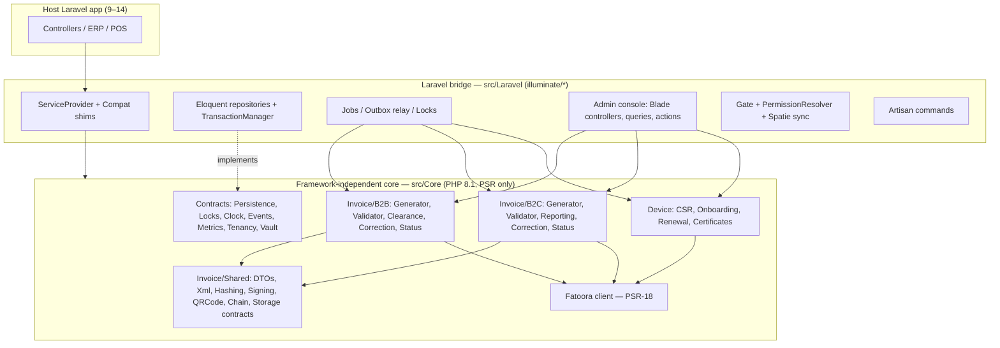
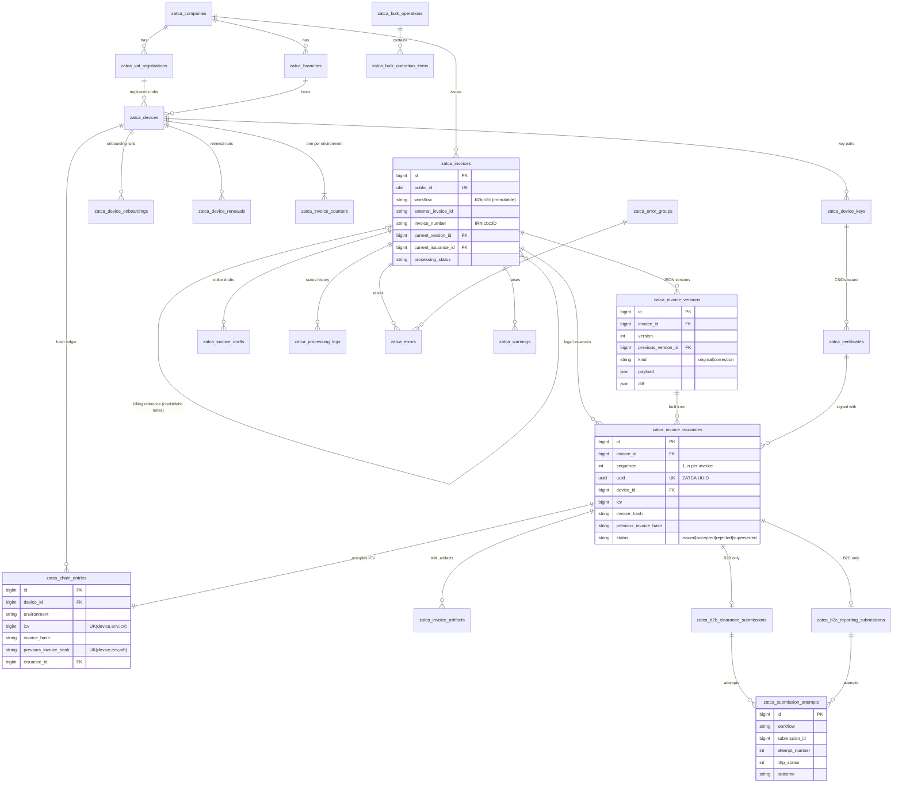
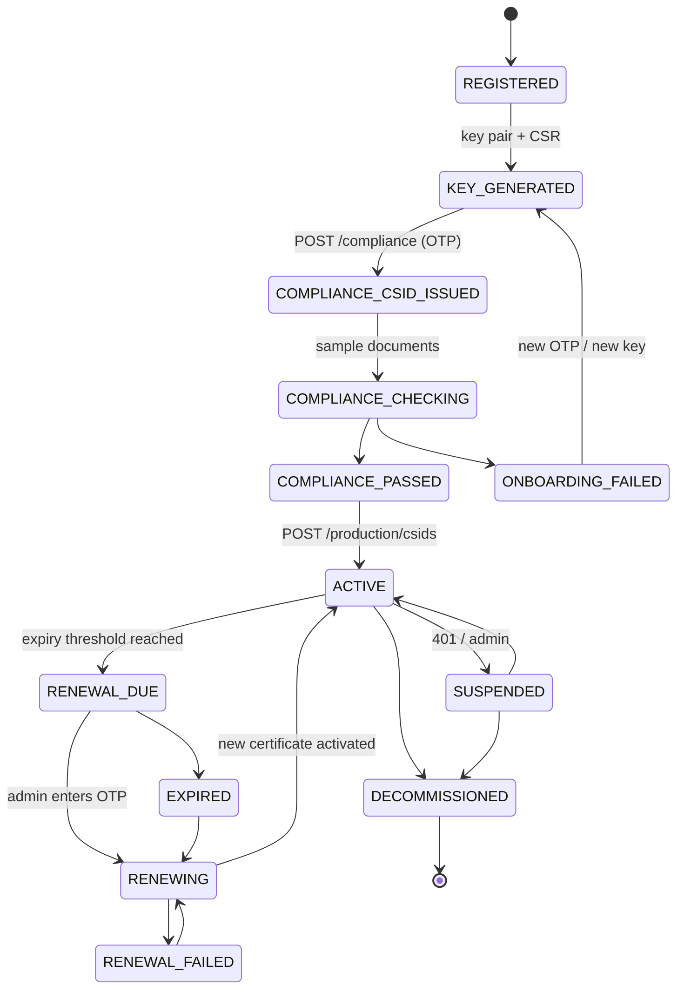
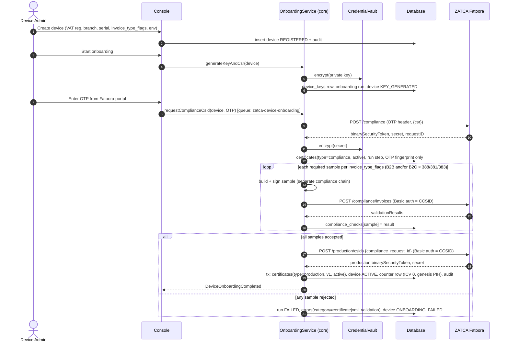
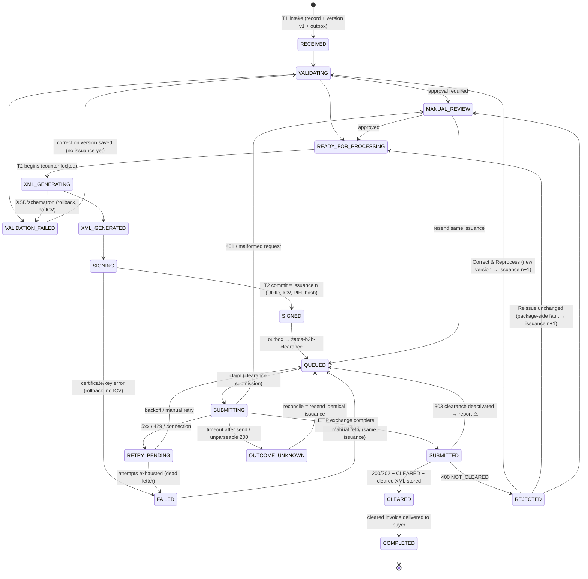
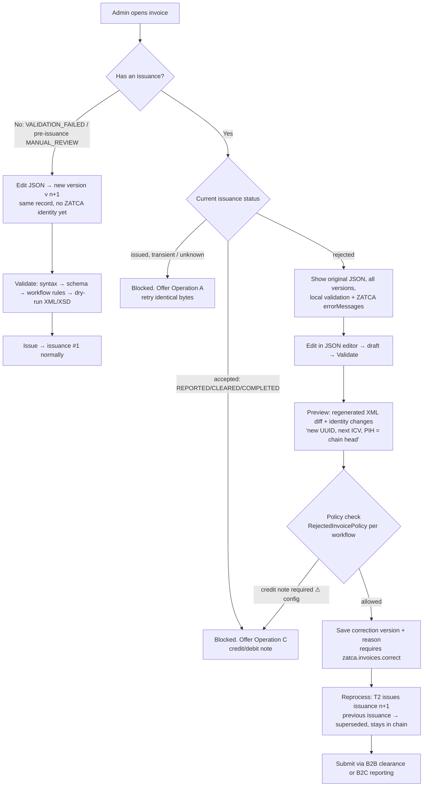
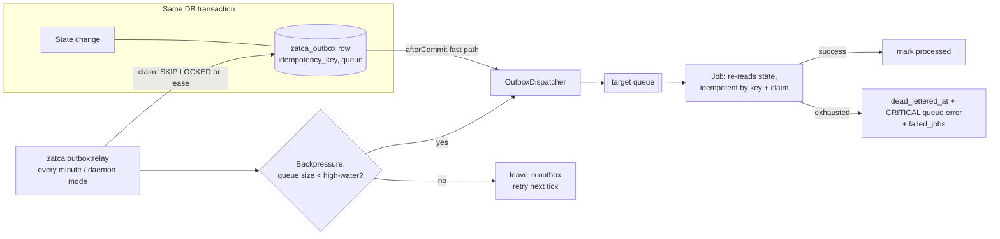

# codingtriplets/laravel-zatca — Architecture v3

**ZATCA Phase 2 (Fatoora) integration engine + management console for Laravel 9–14**
Owner: CodingTriplets Technologies
Status: **REVISED — awaiting explicit approval before implementation**
Date: 2026-11-02
This document is the **source of truth** for the package architecture. Any change in implementation requires a change here first.

**Legend**
- ⚠ = requires confirmation against official ZATCA documentation or the ZATCA sandbox before the dependent code is finalized.
- ⓘ = a design decision of this package (not a ZATCA rule).

---

## Contents

1. [Principles and critical rules](#1-principles-and-critical-rules)
2. [ZATCA ground truth and verification status](#2-zatca-ground-truth-and-verification-status)
3. [Rejected-invoice rules: what ZATCA allows](#3-rejected-invoice-rules-what-zatca-allows)
4. [Package architecture and folder structure](#4-package-architecture-and-folder-structure)
5. [Laravel 9–14 compatibility strategy](#5-laravel-914-compatibility-strategy)
6. [Data model: ER diagram](#6-data-model-er-diagram)
7. [Database schema and relationships](#7-database-schema-and-relationships)
8. [Device onboarding and renewal](#8-device-onboarding-and-renewal)
9. [Separate B2B and B2C pipelines](#9-separate-b2b-and-b2c-pipelines)
10. [B2B invoice lifecycle](#10-b2b-invoice-lifecycle-standard--clearance)
11. [B2C invoice lifecycle](#11-b2c-invoice-lifecycle-simplified--reporting)
12. [Retry, correction and credit/debit note workflows](#12-retry-correction-and-creditdebit-note-workflows)
13. [ICV and PIH concurrency strategy](#13-icv-and-pih-concurrency-strategy)
14. [Transaction and outbox strategy](#14-transaction-and-outbox-strategy)
15. [Queues and horizontal scaling](#15-queues-and-horizontal-scaling)
16. [Management dashboard](#16-management-dashboard)
17. [Permissions matrix](#17-permissions-matrix)
18. [Multi-company and multi-tenant strategy](#18-multi-company-and-multi-tenant-strategy)
19. [Security architecture](#19-security-architecture)
20. [Performance, monitoring and observability](#20-performance-monitoring-and-observability)
21. [Testing strategy](#21-testing-strategy)
22. [Technical risks and unresolved ZATCA questions](#22-technical-risks-and-unresolved-zatca-questions)
23. [Implementation milestones](#23-implementation-milestones)
24. [Change log from v2](#24-change-log-from-v2)

---

## 1. Principles and critical rules

These rules bind every module. A pull request that violates one of them is rejected.

| # | Rule | Enforced by |
|---|---|---|
| R1 | Never compromise ZATCA compliance for performance. | Design review; chain verifier |
| R2 | Never overwrite original invoice JSON. | Append-only `zatca_invoice_versions`; model guards |
| R3 | Never modify previously signed XML. | Immutable `zatca_invoice_artifacts` and content-addressed storage; no XML input endpoints |
| R4 | Never confuse B2B clearance with B2C reporting. | `workflow` fixed at intake; separate services, state graphs, queues, permissions |
| R5 | Never treat HTTP success as invoice acceptance. | `ResponseInterpreter` per workflow; a 200 without a parseable status → `OUTCOME_UNKNOWN` |
| R6 | Never create duplicate ICV values. | DB row lock + CAS + `UK(device_id, environment, icv)` on the chain ledger |
| R7 | Never corrupt PIH sequencing. | Chain ledger `UK(device_id, environment, previous_invoice_hash)` + nightly verifier |
| R8 | Never blindly retry successful invoices. | Conditional claim refuses `REPORTED`/`CLEARED`/`COMPLETED` |
| R9 | Never assume a rejected invoice can be corrected under the same UUID/ICV. | §3; correction always creates a **new issuance** |
| R10 | Never hardcode company/tenant assumptions. | Resolver contracts; no static company config |
| R11 | Never store private credentials in plaintext. | `CredentialVault`; secrets encrypted columns; log redaction |
| R12 | Never create fake implementations to satisfy tests. | Test doubles only at the HTTP transport boundary, fed with recorded sandbox responses; all domain code runs for real |
| R13 | Never claim unsupported Laravel compatibility. | Composer constraint only lists versions with a green CI matrix |
| R14 | Keep complete submission, correction and audit histories. | Append-only tables |
| R15 | Every important operation is idempotent and recoverable. | Outbox, idempotency keys, claim tokens, leases |

---

## 2. ZATCA ground truth and verification status

**Authoritative sources.** These documents govern the implementation. They are retrieved and pinned (version and date) into `docs/zatca-references.md` during Milestone 1:
- *E-Invoicing Detailed Guidelines*
- *XML Implementation Standard*
- *Security Features Implementation Standards*
- *Data Dictionary*
- *Fatoora API specification* (developer portal)
- *ZATCA E-Invoicing SDK* (Java)

Where only community forum answers exist, the item is marked ⚠.

| Topic | Understanding used by the design | Status |
|---|---|---|
| **EGS unit** | The device/solution that generates invoices. It owns a key pair, CSIDs, an ICV counter and a hash chain. | Official concept |
| **OTP** | Obtained by the taxpayer in the Fatoora portal. Used once for `POST /compliance` (onboarding) or `PATCH /production/csids` (renewal). | Renewal flow verified on the developer portal 2026-11-02 (§2.3); simulation ⚠ |
| **CSR** | secp256k1 ECDSA key. The CSR subject and SAN carry the EGS serial (`1-…\|2-…\|3-…`), VAT number, invoice-type flags (e.g. `1100`), address and business category. It also carries the certificate template name extension, which is environment-specific. | Accepted by the developer portal 2026-11-02 (§2.3) |
| **Compliance CSID** | Returned by `POST /compliance`. Used for `POST /compliance/invoices` sample checks and to request the production CSID. | Official flow |
| **Production CSID** | Returned by `POST /production/csids` (with `compliance_request_id`). Used to sign invoices and authenticate reporting/clearance. | Official flow |
| **API authentication** | HTTP Basic with `base64(binarySecurityToken):secret` of the active CSID. **There is no OAuth/bearer token workflow.** | Official; the package exposes `AuthenticationStrategy` for gateway customers |
| **Headers** | `Accept-Version: V2`, `Accept-Language`. The clearance call also sends `Clearance-Status: 1`. | ⚠ Confirm the current header set |
| **ICV** | Per-EGS sequential counter written into each document (`KSA-16`). | Official |
| **PIH** | Base64 SHA-256 of the previous document of the same EGS (`KSA-13`). The first document uses the hash of `"0"`. | Official |
| **Invoice hash** | SHA-256 over the canonicalized XML (C14N 1.1) with `UBLExtensions`, the QR `AdditionalDocumentReference` and `cac:Signature` removed. | Official; ⚠ PHP implements C14N 1.0 natively (see §22) |
| **B2C reporting** | Simplified documents are given to the customer with a QR at the point of sale, then reported via `POST /invoices/reporting/single` within 24 hours. | ⚠ Confirm the deadline in the current guidelines |
| **B2B clearance** | Standard documents are cleared via `POST /invoices/clearance/single` before being shared with the buyer. ZATCA returns the cleared, stamped XML, which is the legal copy. | Official |
| **Clearance switched off** | ZATCA may return `303` when clearance is deactivated; the taxpayer then reports instead. | ⚠ Confirm the semantics |
| **Response codes** | `200` accepted, `202` accepted with warnings, `400` rejected with `validationResults.errorMessages`, `401` authentication, `5xx` server error. | Matches the developer forum; ⚠ confirm against the API spec |
| **Status lookup** | No API for querying the status of a previously submitted invoice. | ⚠ Confirm; this drives the reconciliation strategy (§12.1) |
| **Rate limits** | Not published. | ⚠ Make them configurable; measure in sandbox |
| **Retention** | Statutory record retention applies to invoices and XML. | ⚠ Confirm the period with the customer's tax advisor; the default is 6 years |

### 2.1 CSR generation (verified against *Security Features Implementation Standards* v1.1, 2022-06-24, Table 1)

| CSR input | X.509 location | Rule | Source of value |
|---|---|---|---|
| Common Name | `subject.CN` | Unique name or asset-tracking number of the solution unit | `zatca_devices.name` (manual) |
| EGS Serial Number | SAN dirName `SN` | Format `1-<solution provider>\|2-<model/version>\|3-<serial>`; the package validates it with a regex | `zatca_devices.serial_number`. Default: `1-CodingTriplets\|2-laravel-zatca-{version}\|3-{device_uuid}` |
| Organization Identifier | `subject.organizationIdentifier` (2.5.4.97) and SAN `UID` | VAT or group VAT number: 15 digits, begins and ends with `3` | `zatca_vat_registrations.vat_number` |
| Organization Unit | `subject.OU` | Branch name. **For VAT groups (11th digit of the organization identifier = `1`), it must be the 10-digit TIN of the group member being onboarded** | Branch name or `group_member_tin`. Validated: 11th digit `1` → OU must match `^\d{10}$` |
| Organization Name | `subject.O` | Taxpayer name | `vat_registrations.legal_name` |
| Country | `subject.C` | ISO 3166 alpha-2 (`SA`) | Company address |
| Invoice Type | SAN `title` (2.5.4.12) in the ZATCA SDK config ⚠. The PDF table layout places it near `businessCategory`; confirm with the SDK and sandbox | 4 digits mapped to `TSCZ`: T = standard, S = simplified, C/Z reserved. `1000` = B2B only, `0100` = B2C only, `1100` = both. (Some third-party libraries describe this mapping the other way round; the official table is authoritative) | `zatca_devices.invoice_type_flags`. **Drives which workflow (B2B/B2C) the device may issue** |
| Location | SAN `registeredAddress` (2.5.4.26) | Branch/device address, preferably the National Address short address | `zatca_devices.location` / branch address |
| Industry | SAN `businessCategory` (2.5.4.15) | Industry or sector | `zatca_devices.industry` |
| Certificate template name | Extension 1.3.6.1.4.1.311.20.2 | Developer portal `TSTZATCA-Code-Signing`, simulation `PREZATCA-Code-Signing`, production `ZATCA-Code-Signing` ⚠ (from the SDK and community sources, not the PDF) | Derived from `environment` |

**Cryptographic requirements:**
- Signing is ECDSA with SHA-256 and a 256-bit key (Req. 16). The CSR is PKCS#10 and signed with the private key as proof of possession (Req. 7).
- ⚠ The PDF's certificate profile row reads "Key length: P-256", but the ZATCA SDK and all known working integrations use **secp256k1**. The package uses secp256k1 and keeps the curve in the `CsrProfile` config. Confirmed: the developer portal issued certificates for secp256k1 CSRs (§2.3).

### 2.3 Live verification results (developer-portal sandbox, 2026-11-02)

Run through the package (`tests/Live/SandboxOnboardingTest.php`, demo Laravel 13 app):

| Check | Result |
|---|---|
| `POST /compliance` with our pure-PHP secp256k1 CSR and OTP `123345` | 200 `ISSUED`. The returned certificate's subject equals our CSR subject; issuer `CN=eInvoicing` |
| `POST /production/csids` with Basic auth = compliance CSID | 200 `ISSUED` (no compliance checks were run: **the developer portal does not enforce them**) |
| `PATCH /production/csids` with a new CSR, OTP header, Basic auth = current production CSID | 200 `ISSUED` (Q-Z9 answered for the developer portal) |
| CSR encoding | Signed part byte-identical to `openssl req` with the configuration used by OpenSSL-based integrations |

**CSR encoding facts discovered:**
- OpenSSL's `SN` short name, used by integrations for the EGS serial, means **surname (2.5.4.4)**, not serialNumber (2.5.4.5). ZATCA accepts it. The package defaults to surname and offers `csr.serial_attribute = serialNumber`. ⚠ The official text names no OID.
- All directory strings are UTF8String (Arabic works); countryName is PrintableString. The template name is a UTF8String.
- The Security Standard's Table 1 lists "Invoice Type → businessCategory", but working integrations and the SDK samples put the invoice type in **title (2.5.4.12)** and the industry in businessCategory. The package follows the working form.

**Reporting and clearance (2026-11-02, M5 pipeline, `Zatca::b2c()->issue()` → queue → `/invoices/reporting/single`; `Zatca::b2b()->submit()` → `/invoices/clearance/single`):** 202/200 `REPORTED` and 200 `CLEARED` (with `clearedInvoice`). The request body is `{invoiceHash, uuid, invoice}` with header `Clearance-Status: 0|1`.

**The developer portal's production certificate does not belong to the device key.** On the developer portal, `POST /production/csids` returns a fixed sample certificate (CN `TST-886431145-399999999900003`, serial `1100003803C5F74023B3FC5C5F000100003803`) whatever CSR was used. A document signed with the device key cannot carry that certificate; the signer's self-check rejects the mismatch. So **in the `sandbox` environment only**, the package signs with the compliance certificate (which does belong to the key) and authenticates with the production CSID. ZATCA accepts this with warning `certificate-issuer-name`, and the package records a local warning `SANDBOX_SIGNING_CERTIFICATE`. In `simulation` and `production`, a mismatch makes the device unavailable for issuance (`DeviceUnavailable`); there is no fallback.

Still ⚠ for simulation/production: ZATCA may enforce compliance checks and validate fields more strictly there. M4 adds the checks, and the first simulation onboarding re-verifies this table.
- Keys "must be marked as non-exportable" from the security module (Req. 6). A software vault with disk/envelope encryption is acceptable under Req. 8. An HSM/KMS signer is supported through the `KeyManagementService` contract.
- ZATCA relies on the data the taxpayer supplies without further validation (Req. 5), so the console validates every CSR input before submission.

### 2.2 Buyer identification for B2B when the buyer has no VAT number (verified against the SDK schematron, rules dated 2021-08-19)

| Rule | Severity | Content |
|---|---|---|
| BR-KSA-81 | warning | Standard invoices/notes (`01xxxxx`): if buyer VAT (BT-48) is absent, **other buyer ID (BT-46)** must be present |
| BR-KSA-14 | error | BT-46 `schemeID` ∈ {`TIN`, `CRN`, `MOM`, `MLS`, `700`, `SAG`, `NAT`, `GCC`, `IQA`, `PAS`, `OTH`}; value alphanumeric only. "In case multiple IDs exist then one of the above must be entered following the sequence specified above" |
| BR-KSA-49 | error | If the exemption reason is `VATEX-SA-EDU` or `VATEX-SA-HEA`, BT-46 is mandatory **and must be `NAT`** (applies to B2B and B2C) |
| BR-KSA-44 | error | Buyer VAT, if present: 15 digits, first and last digit `3` |
| BR-CUSTOM-VALIDATION-01 | error | Buyer VAT must differ from seller VAT |
| BR-KSA-42 | warning | Buyer name (BT-44) required on standard invoices |
| BR-KSA-10 | warning | Standard invoices: buyer street, city and country required |
| BR-KSA-63 / 67 | warning | If buyer country = `SA`: street, building no., postal code (5 digits), city, district, country required |
| BR-KSA-25 / 71 | warning | B2C: buyer name required for EDU/HEA exemption and for summary invoices |
| BR-KSA-08 | warning | Seller other ID (BT-29) exactly once, scheme ∈ {`CRN`, `MOM`, `MLS`, `SAG`, `OTH`, `700`} |

**Design consequences:**
- The B2B buyer DTO has `vat_number` (nullable) **or** `identification: {scheme, value}`.
- `StandardBusinessRules` rejects locally, before any ICV is allocated: B2B without buyer VAT and without BT-46 (we treat the BR-KSA-81 warning as an error by default, configurable), an invalid scheme, a non-alphanumeric value, and EDU/HEA without `NAT`.
- **Scheme precedence:** when the payload carries several buyer IDs, the generator picks one by the official order TIN → CRN → MOM → MLS → 700 → SAG → NAT → GCC → IQA → PAS → OTH. Only one `PartyIdentification` is written.
- **A buyer with no VAT and no CR** (e.g. an individual or a non-registered entity on a standard invoice) is valid when identified by `NAT` (Saudi national ID), `IQA` (Iqama), `GCC`, `PAS` or `OTH`.
- ⚠ Community guidance says foreign IDs should use `OTH` rather than `TIN`/`CRN`, and ZATCA added BR-KSA-F-07 format checks (e.g. TIN format) in newer rule sets that are not in the 2021 schematron. The package therefore loads schematrons from the **SDK version pinned in `docs/zatca-references.md`**, not from a hard-coded copy.

---

## 3. Rejected-invoice rules: what ZATCA allows

### 3.0 Official rules (E-Invoicing Detailed Guidelines v1.0, §6.5–6.7)

These statements come from ZATCA's official guideline and are **not** marked ⚠:

| Official rule (paraphrased, §6.7 "Prohibited functions" unless noted) | Package consequence |
|---|---|
| Taxpayers "are not allowed to modify or delete invoices once they are issued". "If a user wishes to cancel an invoice this may only be done through issuing an associated credit note." | Signed XML and issuances are immutable (R3). Cancelling an **accepted** invoice = credit note (Operation C) |
| "A solution might at times generate invalid E-invoice or associated Note documents. Such documents should remain and not be deleted to preserve the continuity of the E-invoice document order." | **Rejected issuances stay in the chain**; correction = a new document at the next ICV |
| The solution unit "must not generate more than one sequence"; all its invoices are "linked using Previous Invoice Hash value into a single chain". Separate units each keep their own sequence | One chain per device, **shared by B2B and B2C** |
| The invoice counter must not be resettable | No counter reset function exists; counters only move forward |
| Logs must not be modifiable | Append-only audit and processing logs |
| The private stamping key must not be exportable | The vault has no export path; no UI/CLI reveals keys |
| §6.5–6.6: standard invoices are shared with the buyer only after clearance; simplified invoices are reported "within 24 hours" of issuance | B2B shares only the cleared XML; B2C `reporting_deadline_at` = issued_at + 24 h (Q-Z12 resolved) |

The guideline does **not** state whether a corrected rejected invoice keeps its invoice number, and it does not say whether a credit note is needed for a *rejected* (never accepted) invoice. Those points stay ⚠ (§3.1).

### 3.1 Evidence collected (as of 2026-11-02)

The forum material below fills the gaps the official guideline leaves open. The only accessible material is the ZATCA Fatoora Developer Community, ZATCA's official developer forum. Poster roles there could not be verified as ZATCA staff, so every point below is ⚠ until confirmed against the *E-Invoicing Detailed Guidelines*. One forum poster cites the Nov 2022 edition, page 77, as covering rejected invoices.

| Question | Forum position | Consistency | Source |
|---|---|---|---|
| Can a rejected invoice be corrected and submitted again? | Yes, for both clearance (B2B) and reporting (B2C) | Consistent | [262](https://zatca1.discourse.group/t/in-case-of-clearance-rejection-from-zatca-what-shall-the-taxpayer-do/262), [1669](https://zatca1.discourse.group/t/seek-clarification-of-resubmitting-rejected-invoices/1669), [585](https://zatca1.discourse.group/t/submit-rejected-invoices/585) |
| Must the UUID change? | **Yes.** "The new invoice should include its own new unique hash, UUID, invoice counter value and timestamp"; "update the HASH, UUID, and ICV" | Consistent. One reply says identifiers can stay only if the hash is unchanged, which means an identical document, i.e. a plain retry. | 262, 1669, 585 |
| Must the ICV change? Can it be reused? | **Yes, new ICV.** "ICV number should not be re-used" | Consistent | 1669, [3351](https://zatca1.discourse.group/t/resubmit-failed-invoices-b2b-or-b2c/3351) |
| PIH of the corrected document | The hash of the **last submitted document** of the EGS, not necessarily the rejected one ("based on immediately preceding document (not necessarily linked to the rejected invoice)") | Consistent. It implies the rejected document **stays in the chain**. | 262, 1669 |
| Issue date (B2B) | "The date on invoice should be updated as non-cleared invoice is not considered as a valid Tax Invoice" | Single source | 262 |
| Invoice number (IRN, `cbc:ID`), B2C | Must stay the **same** as the rejected original ("the transaction has completed before sharing XML with ZATCA") | Single source | 585 |
| Invoice number, B2B | **Conflicting.** One reply recommends a new number, another says keep the original | Unresolved | 3351 |
| Credit note for a rejected invoice? | **Conflicting.** Most replies say credit notes should not be issued for rejected invoices; an earlier reply says cancel via credit note and issue a new invoice | Unresolved; leaning "no" | 585, [258](https://zatca1.discourse.group/t/in-case-we-sent-an-invoice-with-errors-and-got-the-response-from-reporting-api-status-not-reported-what-should-we-do-next/258) |
| Do rejected invoices disappear from the portal after a successful resubmission? | No. "The number of rejected invoices will remain the same." | Single source | 258 |
| Resending an identical document after a timeout | Not addressed | Unknown | — |

### 3.2 Regulatory restrictions the package enforces

1. **A corrected rejected invoice can never reuse the same UUID or ICV.** Any change to the content changes the hash, which requires a new UUID, the next ICV and the current chain-head PIH.
2. **The same UUID/ICV/hash is reused only when the bytes are identical**, i.e. a retry of the exact signed XML (operation A).
3. **A rejected document keeps its ICV slot in the chain.** It is never deleted, rewound or overwritten.
4. **REPORTED/CLEARED documents are never corrected.** A credit or debit note is the only path (operation C).
5. **No credit note is issued for a REJECTED document by default.** `RejectedInvoicePolicy::requiresCreditNote()` returns `false` and can be switched once the official guideline is confirmed ⚠.
6. **B2C:** the IRN (`cbc:ID`) and issue date of the original are retained on reissue by default, because the sale already happened ⚠.
7. **B2B:** the issue date is updated to the reissue time by default ⚠. Whether the IRN is retained is configurable; the default is to retain it ⚠, pending confirmation.

All of these sit in one class per workflow, `B2B\Correction\ClearanceRejectionPolicy` and `B2C\Correction\ReportingRejectionPolicy`, both implementing `RejectedInvoicePolicy`. Once the official text is confirmed, only these classes and their tests change.

### 3.3 Reconciling this with the approved "same internal record" requirement ⓘ

The package separates the two identities:

| Identity | Lives in | Changes on correction? |
|---|---|---|
| **Internal invoice record** (`zatca_invoices.id` + `public_id` ULID, `external_invoice_id`, company, workflow, IRN) | `zatca_invoices` | **Never.** It stays the primary record for the whole lifecycle. |
| **Legal issuance** (UUID, ICV, PIH, hash, signature, QR, signed XML, issue timestamp) | `zatca_invoice_issuances` (1..n per invoice) | **Yes.** Each permitted correction creates issuance n+1 under the same invoice record. |

A rejection therefore **never automatically** creates a new UUID, ICV or invoice record. A new issuance is created only when an authorized person runs *Correct & Reprocess* (or *Reissue unchanged* for package-side errors). The rejected issuance remains attached to the same record, so every UUID, attempt and response stays visible in one place. Credit and debit notes are separate legal documents with different document types, so they get their own internal record, linked to the original through `billing_reference_invoice_id` and shown in the original's history.

---

## 4. Package architecture and folder structure

### 4.1 Layers



**Boundary rule:** nothing in `src/Core` may import `Illuminate\*`. CI enforces this with `deptrac`, which fails the build on any violation.
- The core talks only to its own contracts and to PSR interfaces: PSR-3 log, PSR-18 HTTP client, PSR-17 factories, PSR-20 clock.
- The bridge implements those contracts with Laravel facilities.
- Everything that differs between Laravel versions lives in the bridge, mostly in `src/Laravel/Compat`.

ⓘ It ships as **one Composer package** with the internal boundary enforced, so customers install a single dependency. The core can later be split out as `codingtriplets/zatca-core` without code changes.

### 4.2 Folder structure

```
laravel-zatca/
├── composer.json
├── config/zatca.php
├── database/migrations/                 prefix-aware, anonymous classes (L9+ safe)
├── resources/
│   ├── views/                           Blade console (overridable)
│   ├── lang/{en,ar}/
│   └── schemas/{b2b,b2c}/*.schema.json  JSON Schemas for intake & editor
├── public/                              prebuilt CSS/JS (Tailwind, Alpine, Chart.js, CodeMirror 6)
├── routes/{console.php,api.php}
├── src/
│   ├── Core/
│   │   ├── Contracts/                   Persistence/, Locks/, Storage/, Crypto/, Clock, EventDispatcher,
│   │   │                                MetricsCollector, TenantResolver, CredentialVault, AuthenticationStrategy
│   │   ├── Domain/                      Enums (Workflow, ProcessingStatus, …), ValueObjects (Icv, InvoiceHash,
│   │   │                                VatNumber, Money), StateMachine/, Exceptions/
│   │   ├── Invoice/
│   │   │   ├── Shared/
│   │   │   │   ├── DTOs/                CanonicalInvoice, Party, Line, TaxTotal, BillingReference
│   │   │   │   ├── Xml/                 UBL writer base, Canonicalizer, XsdValidator, SchematronValidator, SafeXmlReader
│   │   │   │   ├── Hashing/             InvoiceHasher
│   │   │   │   ├── Signing/             XadesSigner, CertificateInfo
│   │   │   │   ├── QRCode/              TlvEncoder, QrPayloadBuilder
│   │   │   │   ├── Chain/               ChainService (ICV/PIH allocation), ChainPolicy, ChainVerifier
│   │   │   │   ├── Storage/             ArtifactStore contract, ContentAddressedPath
│   │   │   │   ├── Validation/          shared JSON-schema + VAT arithmetic rules
│   │   │   │   └── Correction/          VersionService, JsonDiff (RFC 6902), RejectedInvoicePolicy contract
│   │   │   ├── B2B/
│   │   │   │   ├── Generator/           StandardInvoiceGenerator (388/381/383, subtype 01…)
│   │   │   │   ├── Validator/           StandardBusinessRules (buyer VAT/address, BR-KSA-* for standard)
│   │   │   │   ├── Clearance/           ClearanceService, ClearanceResponseInterpreter, ClearedXmlExtractor
│   │   │   │   ├── Correction/          ClearanceRejectionPolicy, B2BCorrectionService
│   │   │   │   └── Status/              B2BStateMachine (transition graph)
│   │   │   └── B2C/
│   │   │       ├── Generator/           SimplifiedInvoiceGenerator (388/381/383, subtype 02…)
│   │   │       ├── Validator/           SimplifiedBusinessRules (QR mandatory, B2C rules)
│   │   │       ├── Reporting/           ReportingService, ReportingResponseInterpreter, DeadlineCalculator
│   │   │       ├── Correction/          ReportingRejectionPolicy, B2CCorrectionService
│   │   │       └── Status/              B2CStateMachine
│   │   ├── Device/                      KeyGenerator, CsrBuilder, OnboardingService, RenewalService,
│   │   │                                ComplianceSampleFactory, CertificateParser
│   │   ├── Fatoora/                     FatooraClient (PSR-18), Endpoints, Environment, Auth/CsidBasicAuth,
│   │   │                                ResponseParser, TransportException taxonomy
│   │   └── Errors/                      ErrorCategory, Severity, Fingerprinter, Sanitizer, ErrorRecorder contract
│   └── Laravel/
│       ├── ZatcaServiceProvider.php
│       ├── Facades/Zatca.php
│       ├── Compat/                      LaravelVersion, AfterCommit, ScheduleRegistrar, MiddlewareRegistrar, CarbonCompat
│       ├── Database/                    Models/, Repositories/, EloquentTransactionManager, DatabaseCapabilities
│       ├── Invoice/
│       │   ├── B2B/Jobs/                GenerateStandardInvoiceJob, ClearStandardInvoiceJob, RetryClearanceJob
│       │   └── B2C/Jobs/                GenerateSimplifiedInvoiceJob, ReportSimplifiedInvoiceJob, RetryReportingJob
│       ├── Device/Jobs/                 OnboardDeviceJob, RenewDeviceJob, CheckRenewalsJob
│       ├── Outbox/                      OutboxWriter, OutboxRelay, OutboxDispatcher, Backpressure
│       ├── Locks/                       CacheLockAdapter, DbLeaseLock
│       ├── Storage/                     FilesystemArtifactStore (Laravel disks: local, s3, custom)
│       ├── Http/                        Controllers/{Dashboard,B2B,B2C,Devices,Errors,Queue,ApiLogs,Reports,
│       │                                Audit,Settings}, Queries/, Actions/, Requests/, Middleware/, ViewModels/
│       ├── Authorization/               Abilities, PermissionResolver, SpatieSync
│       ├── Tenancy/                     TenantScope, resolvers (null, column, callback)
│       ├── Monitoring/                  HealthChecks, LogMetrics, PrometheusMetrics (optional)
│       ├── Console/                     zatca:install, outbox:relay, chain:verify, audit:verify,
│       │                                devices:check-renewals, stats:rollup, archive, prune, health,
│       │                                permissions:sync, credentials:reencrypt, documents:gc, bench
│       ├── Events/  Listeners/  Notifications/
├── tests/{Unit,Integration,Concurrency,Compatibility,Performance,Fixtures/zatca-sdk}
├── docs/
└── .github/workflows/{ci.yml,concurrency.yml,sandbox-contract.yml,perf.yml}
```

Jobs live under `src/Laravel/Invoice/{B2B,B2C}/Jobs` rather than inside `src/Core` because queues are a Laravel facility. The B2B/B2C split mirrors the core.

---

## 5. Laravel 9–14 compatibility strategy

### 5.1 Version facts (verify each when the CI matrix is built)

| Laravel | Released / status at 2026-11-02 | PHP supported by Laravel | Package PHP range | Testbench | PHPUnit |
|---|---|---|---|---|---|
| 9 | Security support ended Feb 2024 (EOL) | 8.0–8.2 | **8.1–8.2** | ^7 | 9.5 |
| 10 | Security support ended Feb 2025 (EOL) | 8.1–8.3 | 8.1–8.3 | ^8 | 10 |
| 11 | Security support ended Mar 2026 (EOL) | 8.2–8.4 | 8.2–8.4 | ^9 | 10.5/11 |
| 12 | Supported (security to ~Feb 2027) | 8.2–8.4 (+8.5 if CI passes) | 8.2–8.5 | ^10 | 11 |
| 13 | Released 2026-03-17; supported | 8.3+ | 8.3–8.5 | ^11 | 11/12 ⚠ |
| 14 | **Not released.** Expected ~Q1 2027, PHP 8.4+ (Laravel News estimate) | — | — | — | — |

### 5.2 Policy

- **PHP floor 8.1** ⓘ, which needs approval (§22, Q-L1). PHP 8.1 gives native enums, readonly properties and Eloquent enum casts (Laravel 9+). Laravel 9 runs on PHP 8.1/8.2, so **no customer has to upgrade Laravel**. Customers on PHP 8.0 (EOL since Nov 2023) would have to upgrade PHP. The alternative is an 8.0 floor without enums or readonly properties, which costs a lot of type safety.
- **Composer constraint:**
  - `"php": "^8.1"`, plus `illuminate/{support,database,queue,bus,cache,console,contracts,events,http,routing,view,filesystem}: ^9.0|^10.0|^11.0|^12.0|^13.0`.
  - `^14.0` is added **only in the release whose CI matrix is green against the stable Laravel 14 and Testbench**.
  - Before that, a scheduled CI job runs against `14.x-dev` and is allowed to fail.
- **Support statement:** the README's "Supported versions" table is generated from the last green CI run. EOL versions (9, 10, 11) are marked *"supported by this package; framework no longer receives security fixes"*.
- **Third-party floors** must satisfy L9 and L13 at the same time:
  - `phpseclib/phpseclib ^3.0` (crypto, CSR, X.509 without temp config files)
  - `opis/json-schema ^2.3`
  - `chillerlan/php-qrcode ^5.0` ⚠ (check PHP range)
  - `guzzlehttp/guzzle ^7.5`
  - `psr/log ^1|^2|^3`
  - `nesbot/carbon ^2.62|^3`

### 5.3 Compat rules: features shared code must not use

| Avoid (introduced in) | Use instead |
|---|---|
| `Model::casts()` method (L11) | `$casts` property |
| `Schedule` facade / `routes/console.php` scheduling (L11) | `$this->callAfterResolving(Schedule::class, …)` in the provider |
| `bootstrap/app.php` middleware configuration (L11) | `Router::aliasMiddleware()` / `middlewareGroup()` in the provider |
| `ShouldDispatchAfterCommit` on events (L10.x) | `Compat\AfterCommit::dispatch()` wrapping `DB::afterCommit()` (L8+) |
| `Context`, `Concurrency`, `Number` facades (L11); `Process` (L10) | Core services / plain PHP |
| `whereAny`/`whereAll` (L10.x), `Schema::hasIndex` (L11) | Explicit query builder; migration-time introspection via Doctrine-free checks |
| Eloquent attribute classes `#[Scope]`, `#[ObservedBy]` (L11/12) | Classic `scopeX()` and `boot()` registration |
| `ValidationRule` interface (L10) | Business validation is in the core (opis + rule classes); FormRequests use string rules only |
| Laravel `Http` client (behaviour differs across versions) | Core PSR-18 client on Guzzle; tests use Guzzle `MockHandler` with recorded responses |
| Carbon 3 `diffIn*` semantics (float, signed) | `CarbonCompat::seconds/days()` helpers |
| Blade `@session`, `@use` (L11) | Plain Blade directives and components (L7+) |
| PHPUnit annotation-only or attribute-only metadata | Test methods named `test_*`. Data providers declared with **both** `@dataProvider` and `#[DataProvider]` (PHPUnit 9 reads the annotation, 10+ the attribute); providers are `static` |

A `Compat\LaravelVersion` helper exists for the rare runtime branch. Every branch is covered by a test in the matrix.

### 5.4 CI matrix (GitHub Actions)

- **Unit + integration:** every supported Laravel × PHP pair in §5.1 × {`prefer-lowest`, `prefer-stable`} on SQLite.
- **Database matrix:** latest PHP per Laravel × {MySQL 8.0/8.4, MariaDB 10.11, PostgreSQL 14/16, SQL Server 2022}.
- **Concurrency suite:** (§21) runs on MySQL and PostgreSQL.
- **Laravel 14:** `14.x-dev` job, `continue-on-error: true` until stable, then promoted.
- **Static checks:** PHPStan (level 8) and deptrac (core boundary).

---

## 6. Data model: ER diagram



The outbox, audit, bulk-operation, statistics and settings tables are omitted from the diagram for readability. They are listed in §7.

---

## 7. Database schema and relationships

### 7.1 Conventions

- **Prefix:** `zatca.database.table_prefix` (default `zatca_`). **Connection:** `zatca.database.connection` (default app connection).
- **Money:** `decimal(20,2)` for document totals. Line-level precision stays in the JSON payload.
- **Timestamps:** stored in UTC. ZATCA `IssueDate`/`IssueTime` are rendered in `zatca.timezone` (default `Asia/Riyadh`) ⚠.
- **Append-only tables** (marked **AO**) have `created_at` only. Their models throw on update/delete, and strict mode documents DB triggers/grant revocation.
- **Foreign keys** are on by default. `zatca.database.foreign_keys=false` is for partitioned MySQL deployments (§20.3).
- **JSON columns:** `json` on MySQL/MariaDB/SQLite/SQL Server, `jsonb` on PostgreSQL. No hot-path query reads inside JSON.

### 7.2 Organisation and devices

| Table | Key columns | Constraints / indexes |
|---|---|---|
| `zatca_companies` | `tenant_id`, `name_en`, `name_ar`, `crn`, `address` json (building no, street, district, city, postal code, additional no, country), `status`, soft deletes | `IX(tenant_id, status)` |
| `zatca_vat_registrations` | `company_id`, `vat_number` (15 digits), `is_group`, `group_member_tin`, `legal_name`, `address` json, `status` | `UK(tenant_id, vat_number, group_member_tin)` |
| `zatca_branches` | `company_id`, `code`, `name`, `address_override` json, soft deletes | `UK(company_id, code)` |
| `zatca_devices` | `tenant_id`, `company_id`, `vat_registration_id`, `branch_id`, `device_uuid`, `name`, `serial_number`, `invoice_type_flags` (e.g. `1100`), `environment`, `industry`, `location`, `lifecycle_status` (§8), `active_certificate_id`, `certificate_expiry`, `submissions_paused_until`, `decommissioned_at` | `UK(device_uuid)`, `IX(company_id, lifecycle_status)`, `IX(certificate_expiry)` |
| `zatca_device_keys` | `device_id`, `environment`, `algorithm` (secp256k1), `encrypted_private_key`, `public_key`, `csr` (public), `key_fingerprint`, `vault_key_id`, `generated_by` | `IX(device_id, created_at)` |
| `zatca_certificates` (certificate history) | `device_key_id`, `device_id`, `environment`, `type` (compliance/production), `version`, `certificate` (public PEM), `encrypted_secret`, `request_id`, `serial`, `fingerprint`, `valid_from`, `valid_until`, `status` (pending/active/superseded/revoked/expired), `activated_at`, `superseded_at` | `UK(device_id, environment, type, version)`. One `active` per (device, env, type), enforced under a device lock, plus a partial unique index on PostgreSQL |
| `zatca_device_onboardings` | `device_id`, `environment`, `status`, `current_step`, `otp_fingerprint` (salted hash; OTP never stored), `compliance_request_id`, `compliance_checks` json (per sample doc: type, uuid, hash, status, messages), `initiated_by`, `completed_at`, `error` | `IX(device_id, created_at)` |
| `zatca_device_renewals` | `device_id`, `environment`, `previous_certificate_id`, `new_certificate_id`, `status`, `otp_fingerprint`, `initiated_by`, `completed_at`, `error` | `IX(device_id, created_at)` |

### 7.3 Invoices, versions, issuances, chain

**`zatca_invoices`** is the internal primary record and stays narrow.

| Group | Columns |
|---|---|
| Identity | `id`, `public_id` (ULID), `tenant_id`, `company_id`, `vat_registration_id`, `branch_id`, `device_id` (preferred device), `environment`, `workflow` (`b2b`/`b2c`, immutable), `external_invoice_id`, `invoice_number` (IRN) |
| Classification | `document_type` (388/381/383), `subtype_flags` (7-char, e.g. `0100000`/`0200000`), `billing_reference_invoice_id` (self FK, for 381/383) |
| Pointers | `current_version_id`, `current_issuance_id`, `issuance_count`, `current_uuid` (denormalized for search) |
| Dates | `invoice_date` (original business date), `first_issued_at`, `last_submitted_at`, `reported_at`, `cleared_at`, `reporting_deadline_at` (B2C), `next_retry_at`, `status_changed_at` |
| Amounts | `currency`, `total_excl_vat`, `vat_total`, `total_incl_vat`, `buyer_vat_number` |
| Status dimensions | `processing_status`, `validation_status`, `submission_status`, `reporting_status`, `clearance_status`, `zatca_response_status` |
| Ops | `attempts`, `last_error_code`, `unresolved_error_count`, `warning_count`, `requires_approval`, `approved_by`, `approved_at`, `created_by` |
| Lifecycle | Soft delete allowed **only** while `issuance_count = 0` |

**`zatca_invoices` indexes:**
- `UK(public_id)`
- `UK(company_id, external_invoice_id)`: idempotent intake
- `IX(tenant_id, workflow, invoice_date, id)`: listing + cursor pagination
- `IX(company_id, workflow, invoice_date, id)`
- `IX(workflow, processing_status, status_changed_at)`
- `IX(reporting_status, reporting_deadline_at)`
- `IX(clearance_status, invoice_date)`
- `IX(submission_status, next_retry_at)`
- `IX(invoice_number)`, `IX(current_uuid)`, `IX(buyer_vat_number)`

**`zatca_invoice_versions`** (correction history, AO):

| Column | Meaning |
|---|---|
| `invoice_id`, `version` | `UK(invoice_id, version)`. v1 = original |
| `previous_version_id` | Self FK |
| `kind` | `original` / `correction` |
| `payload` | Full JSON of this version |
| `payload_sha256` | Integrity |
| `diff` | RFC 6902 patch vs the previous version |
| `changed_fields` | JSON pointer list (for audit and UI) |
| `reason` | Required for corrections |
| `created_by`, `created_at` | Who and when |
| `validation_result` | Schema, business-rule and XSD/schematron results at save time |
| `issuance_id` | The issuance built from this version, if any. This is the regenerated-XML reference; the issuance gives the signature version (certificate) and submission attempts |

**`zatca_invoice_drafts`:** mutable, per user (`invoice_id`, `user_id`, `payload`, `base_version_id`, `updated_at`). Drafts never affect processing. Saving a draft as a correction copies it into a new version.

**`zatca_invoice_issuances`** (one per legal document instance, AO except status columns):

| Column | Meaning |
|---|---|
| `invoice_id`, `sequence` | `UK(invoice_id, sequence)` |
| `version_id` | The payload version used |
| `uuid` | ZATCA `cbc:UUID`, `UK(uuid)` |
| `device_id`, `environment`, `icv`, `previous_invoice_hash`, `invoice_hash` | Chain data (duplicated from the ledger for reads) |
| `issue_date`, `issue_time` | As written in the XML (policy-dependent on reissue, §3.2) |
| `certificate_id` | Signing certificate (signature version) |
| `signature_value`, `signing_time` | |
| `qr_payload` | TLV base64 |
| `reason` | `initial` / `correction` / `reissue_unchanged` |
| `supersedes_issuance_id` | Self FK |
| `status` | `issued` / `accepted` / `accepted_with_warnings` / `rejected` / `superseded` |
| `issued_by`, `issued_at` | Chain commit time |

**`zatca_chain_entries`** (invoice hash history, AO): `device_id`, `environment`, `icv`, `invoice_hash`, `previous_invoice_hash`, `issuance_id`, `committed_at`.
- `UK(device_id, environment, icv)`: no duplicate ICV.
- `UK(device_id, environment, previous_invoice_hash)`: no fork. Each hash may be the predecessor of exactly one document.

**`zatca_invoice_counters`:** `device_id`, `environment`, `last_icv`, `last_invoice_hash`, `last_issuance_id`, `lock_version`, `UK(device_id, environment)`.

**`zatca_invoice_artifacts`** (AO): `issuance_id`, `kind` (`signed_xml`, `cleared_xml`, `qr_png`, `preview_xml`), `disk`, `path` (content-addressed), `sha256`, `bytes`, `encrypted` bool, `mime`. Index `IX(issuance_id, kind)`. No XML is stored in hot tables.

### 7.4 Submissions (separate per workflow)

| Table | Key columns |
|---|---|
| `zatca_b2b_clearance_submissions` | `issuance_id` (UK), `invoice_id`, `status` (pending/in_flight/cleared/cleared_with_warnings/not_cleared/clearance_deactivated/unknown/failed), `clearance_status_raw`, `cleared_artifact_id`, `attempts`, `claim_token`, `claimed_until`, `first_attempt_at`, `completed_at`, `manual` bool, `requested_by` |
| `zatca_b2c_reporting_submissions` | `issuance_id` (UK), `invoice_id`, `status` (pending/in_flight/reported/reported_with_warnings/not_reported/unknown/failed), `reporting_status_raw`, `deadline_at`, `deadline_breached` bool, `attempts`, `claim_token`, `claimed_until`, `first_attempt_at`, `completed_at`, `manual`, `requested_by` |
| `zatca_submission_attempts` (AO, API log) | `workflow`, `submission_id`, `invoice_id`, `issuance_id`, `attempt_number`, `endpoint`, `environment`, `request_headers` (sanitized), `request_body_ref` (artifact or inline JSON without the XML), `response_body`, `http_status`, `zatca_status`, `outcome` (accepted/accepted_with_warnings/rejected/transient/auth/unknown/client_error), `error_code`, `error_message`, `started_at`, `completed_at`, `duration_ms`, `triggered_by`, `bulk_operation_id`, `idempotency_key`. Indexes `IX(workflow, submission_id, attempt_number)`, `IX(outcome, started_at)`, `IX(started_at)` |

### 7.5 Errors, history, audit, ops

| Table | Key columns | Notes |
|---|---|---|
| `zatca_errors` | `invoice_id`, `issuance_id`, `device_id`, `company_id`, `workflow`, `category`, `severity`, `code`, `message`, `details` (sanitized json), `source`, `attempt_number`, `submission_attempt_id`, `group_id`, `fingerprint`, `is_resolved`, `resolved_at`, `resolved_by`, `resolution_note` | `IX(is_resolved, severity, created_at)`, `IX(invoice_id)`, `IX(group_id)`, `IX(workflow, category, created_at)` |
| `zatca_error_groups` | `fingerprint`, `workflow`, `category`, `code`, `normalized_message`, `occurrences`, `open_count`, `first_seen_at`, `last_seen_at` | `UK(fingerprint)` |
| `zatca_warnings` | `invoice_id`, `issuance_id`, `workflow`, `source` (local/zatca), `code`, `message`, `details`, `is_acknowledged`, `acknowledged_by`, `acknowledged_at` | `IX(is_acknowledged, created_at)` |
| `zatca_processing_logs` (AO) | `invoice_id`, `issuance_id`, `workflow`, `dimension`, `event`, `previous_status`, `new_status`, `message`, `metadata`, `actor_id`, `job_id` | `IX(invoice_id, id)` |
| `zatca_audit_logs` (AO, hash-chained) | `tenant_id`, `actor_id`, `actor_type`, `action`, `subject_type`, `subject_id`, `changes` json, `ip`, `user_agent`, `prev_hash`, `row_hash` | `IX(subject_type, subject_id)`, `IX(actor_id, created_at)` |
| `zatca_outbox` | `aggregate_type`, `aggregate_id`, `event_type`, `queue`, `payload`, `idempotency_key`, `available_at`, `claimed_by`, `claimed_until`, `attempts`, `processed_at`, `dead_lettered_at`, `last_error` | `UK(idempotency_key)`, `IX(processed_at, queue, available_at)` |
| `zatca_bulk_operations` / `_items` | type, filters, workflow, status, counters, requested_by, approved_by / per-item result | `UK(bulk_operation_id, invoice_id)` |
| `zatca_stats_daily` | `day`, `tenant_id`, `company_id`, `device_id`, `workflow`, `document_type`, `environment`, `processing_status`, `count`, `total_incl_vat`, `vat_total`, `api_p50_ms`, `api_p95_ms`, `error_count` | UK on all dimension columns |
| `zatca_settings` | `tenant_id`, `key`, `value` json, `updated_by` | Non-secret settings only |

### 7.6 Database support

MySQL/MariaDB: every package table is created with **InnoDB** explicitly. This was verified on 2026-11-02: a MariaDB 10.6 server that defaulted to MyISAM silently ignored transactions and row locks, so two processes allocated the same ICV (the ledger unique key refused the duplicate). The migration helper forces InnoDB and `SchemaTest` asserts it.

| Engine | Support | Notes |
|---|---|---|
| MySQL 8.0+ / 8.4 | Full | `FOR UPDATE`, `SKIP LOCKED` |
| MariaDB 10.6+ | Full | `SKIP LOCKED` from 10.6 |
| PostgreSQL 13+ | Full (recommended at scale) | `jsonb`, partial unique indexes, partitioning |
| SQL Server 2019+ | Supported | `lockForUpdate` → `UPDLOCK, ROWLOCK`. The outbox uses leases instead of `SKIP LOCKED` |
| SQLite 3.35+ | Development/tests only | Single writer. Boot warning if the environment is production |

`DatabaseCapabilities` chooses between the engine-specific path and the portable fallback.

---

## 8. Device onboarding and renewal

### 8.1 Device lifecycle



### 8.2 Onboarding sequence



**Notes on onboarding:**
- The compliance samples use their own chain inside the onboarding run. They never touch the production counter.
- ⚠ Confirm the exact sample set and the counter/PIH expectations for compliance checks.

### 8.3 Renewal sequence

```mermaid
sequenceDiagram
    autonumber
    participant S as Scheduler (zatca:devices:check-renewals)
    actor A as Device Admin
    participant R as RenewalService (core)
    participant L as Device lock (Cache lock + DB row lock)
    participant DB as Database
    participant Z as ZATCA Fatoora
    S->>DB: certificates expiring within 30/14/7/1 days
    S-->>A: DeviceRenewalRequired (mail/Slack/db notification)
    A->>R: Renew (enters OTP)  [queue: zatca-device-renewal]
    R->>L: acquire renewal lock for device+env
    R->>DB: new device_keys row (new key + CSR), renewal run RENEWING
    R->>Z: PATCH /production/csids (OTP header, {csr}, Basic auth = current PCSID) ⚠
    Z-->>R: new binarySecurityToken, secret
    R->>DB: tx: new certificate v(n+1) active; previous → superseded; device.active_certificate_id; audit; outbox DeviceRenewed
    R->>L: release
    Note over R,DB: Workers pick up the new certificate on their next lookup (cache key = certificate id). In-flight submissions keep the issuance's original certificate for its signature; auth uses the active certificate ⚠
```

**Notes on renewal:**
- **Failure** keeps the old certificate active. The run is marked `RENEWAL_FAILED`, a CRITICAL error is raised if expiry is within 7 days, and `DeviceRenewalFailed` fires.
- ⚠ Whether renewal requires repeating the compliance checks, and which credential authenticates `PATCH`, is confirmed in sandbox.

---

## 9. Separate B2B and B2C pipelines

### 9.1 What is shared and what is not

| Concern | Shared (`Invoice/Shared`) | B2B (`Invoice/B2B`) | B2C (`Invoice/B2C`) |
|---|---|---|---|
| DTOs | `CanonicalInvoice`, parties, lines, totals | `StandardInvoice` (buyer required) | `SimplifiedInvoice` |
| JSON schema | Common definitions | `b2b/*.schema.json` | `b2c/*.schema.json` |
| Business rules | VAT arithmetic, rounding, currency | Buyer VAT/address and standard-only BR-KSA rules | Simplified-only rules, QR mandatory, summary/nominal/export flags as applicable ⚠ |
| XML | UBL writer primitives, canonicalizer, XSD/schematron runner | `StandardInvoiceGenerator` | `SimplifiedInvoiceGenerator` |
| Hash / sign / QR | `InvoiceHasher`, `XadesSigner`, `TlvEncoder` | Signing ⓘ (decision Q-Z5). QR: the legal QR is in the **cleared XML** returned by ZATCA ⚠ | Signing mandatory. QR mandatory at issuance (given to the customer before reporting) |
| Chain (ICV/PIH) | **One chain per device + environment, shared by both workflows** | Uses `ChainService` | Uses `ChainService` |
| Submission | `FatooraClient` transport | `ClearanceService` → `/invoices/clearance/single` | `ReportingService` → `/invoices/reporting/single` |
| Response handling | `ResponseParser` (JSON → DTO) | `ClearanceResponseInterpreter` (stores cleared XML; handles 303 ⚠) | `ReportingResponseInterpreter` (deadline tracking) |
| State graph | `StateMachine` engine | `B2BStateMachine` | `B2CStateMachine` |
| Correction | `VersionService`, `JsonDiff` | `ClearanceRejectionPolicy` | `ReportingRejectionPolicy` |
| Jobs / queues | Outbox | `zatca-b2b-*` | `zatca-b2c-*` |
| Permissions / UI | Layout | `zatca.b2b.*`, B2B menu | `zatca.b2c.*`, B2C menu |
| Post-acceptance | — | Deliver the cleared XML/PDF to the buyer via the `ClearedInvoiceDelivery` hook → `COMPLETED` | Optional customer-copy hook → `COMPLETED` |

**Important:** separating the pipelines **must not split the device chain**. ZATCA chains every document an EGS issues, B2B and B2C alike, so both pipelines allocate from the same `zatca_invoice_counters` row. The device's `invoice_type_flags` decide which workflows it may issue.

**VAT category rule (shared, learned from a bug reported against zatca-xml-js, issue #8):**
- Every line must have a VAT category (`S`, `Z`, `E`, `O`). The generator always emits one `TaxSubtotal` per distinct (category, rate) pair, for single-line and multi-line invoices alike, so BR-S-01 and BR-Z/E/O-01 cannot fail through a missing breakdown.
- A missing category is **inferred only when it is unambiguous**: rate 15% → `S`. The inference is recorded as a warning on the invoice. Rate 0% is ambiguous (zero-rated, exempt or out of scope, each needing different reason codes), so the invoice is rejected locally with a field-level error, before any ICV is used.
- `Z` and `E` require an exemption reason code and text (BR-KSA-CL-04 / BR-KSA-69).

`workflow` is set at intake: from the explicit payload field, or derived from the subtype `01`/`02` with a mismatch rejected. It is immutable afterwards. A B2B document can never be routed to a B2C service and vice versa; services assert the workflow on entry.

### 9.2 Status dimensions

| Dimension | B2B values | B2C values |
|---|---|---|
| `processing_status` | §10 graph | §11 graph |
| `validation_status` | `PENDING`, `VALID`, `VALID_WITH_WARNINGS`, `INVALID` | same |
| `submission_status` | `NOT_STARTED`, `PENDING`, `IN_FLIGHT`, `DELIVERED`, `UNKNOWN`, `FAILED_TRANSIENT`, `FAILED_PERMANENT` | same |
| `clearance_status` | `PENDING`, `CLEARED`, `CLEARED_WITH_WARNINGS`, `NOT_CLEARED`, `CLEARANCE_DEACTIVATED` | always `NOT_APPLICABLE` |
| `reporting_status` | `NOT_APPLICABLE`; `REPORTED*` only if clearance is deactivated (303) ⚠ | `PENDING`, `REPORTED`, `REPORTED_WITH_WARNINGS`, `NOT_REPORTED` |
| `zatca_response_status` | Raw `clearanceStatus` | Raw `reportingStatus` |

The invoice-level status columns always reflect the **current issuance**. Every issuance's own outcome is preserved in its submission row and attempts.

---

## 10. B2B invoice lifecycle (standard → clearance)



**B2B specifics:**
- The document must not be shared with the buyer before `CLEARED`. The console and the `ClearedInvoiceDelivery` hook only expose the **cleared XML** artifact.
- On reissue, `issue_date`/`issue_time` are set to the reissue time (`ClearanceRejectionPolicy`) ⚠. The IRN is retained by default (configurable) ⚠.

---

## 11. B2C invoice lifecycle (simplified → reporting)

```mermaid
stateDiagram-v2
    [*] --> RECEIVED : T1 intake
    RECEIVED --> VALIDATING
    VALIDATING --> VALIDATION_FAILED
    VALIDATING --> READY_FOR_PROCESSING
    VALIDATION_FAILED --> VALIDATING : correction version saved (no issuance yet)
    READY_FOR_PROCESSING --> XML_GENERATING : T2 (often synchronous at POS)
    XML_GENERATING --> XML_GENERATED
    XML_GENERATED --> SIGNING
    SIGNING --> SIGNED : T2 commit = issuance n; QR available to the customer
    XML_GENERATING --> VALIDATION_FAILED : rollback, no ICV
    SIGNING --> FAILED : rollback, no ICV
    SIGNED --> QUEUED : outbox → zatca-b2c-reporting (deadline = issued_at + 24h ⚠)
    QUEUED --> SUBMITTING : claim (reporting submission)
    SUBMITTING --> SUBMITTED : interpreting
    SUBMITTED --> REPORTED : 200/202 + REPORTED
    SUBMITTED --> REJECTED : 400 NOT_REPORTED
    SUBMITTING --> RETRY_PENDING : 5xx / 429 / connection
    SUBMITTING --> OUTCOME_UNKNOWN
    OUTCOME_UNKNOWN --> QUEUED : resend identical issuance
    RETRY_PENDING --> QUEUED : compressed backoff (fits deadline)
    RETRY_PENDING --> FAILED
    SUBMITTING --> MANUAL_REVIEW : 401 / malformed
    FAILED --> QUEUED : manual retry
    MANUAL_REVIEW --> QUEUED
    REJECTED --> VALIDATING : Correct & Reprocess (issuance n+1; IRN + original date kept ⚠)
    REJECTED --> READY_FOR_PROCESSING : Reissue unchanged
    REJECTED --> MANUAL_REVIEW
    REPORTED --> COMPLETED
    COMPLETED --> [*]
```



### 11.1 B2C reporting mode and response contract

`zatca.b2c.reporting_mode`:
- **`queue`** (default): the request does intake, validation and issuance synchronously (T1 + T2), then returns. Reporting to ZATCA happens on the `zatca-b2c-reporting` queue. The outcome (REPORTED / NOT_REPORTED + errors and warnings) is saved on the invoice when the worker finishes, and `InvoiceReported` / `InvoiceRejected` events fire.
- **`sync`**: the same, plus the ZATCA reporting call inside the request. The response then includes the ZATCA outcome. Latency includes the ZATCA round-trip (typically hundreds of ms to seconds), so this mode is for low volume only.

Available both as a PHP API, `Zatca::b2c()->issue(array $payload): IssueResult` (with `->toArray()`), and as an optional HTTP endpoint, `POST {api_prefix}/b2c/invoices`. The endpoint is off by default; middleware, for example Sanctum or a token, is configurable.

**Queue-mode success** (HTTP 201; or 200 with the original result when the same `external_invoice_id` is repeated, which makes client retries safe):

```json
{
  "status": true,
  "message": "invoice queued",
  "qr": "<base64 TLV QR string>",
  "counter": 10452,
  "uuid": "6f3c…",
  "invoice_id": "01JBX…",
  "invoice_hash": "y1o3…",
  "reporting_deadline": "2026-11-03T09:14:03Z"
}
```

`status`, `message`, `qr` and `counter` (the ICV) are the requested fields. `uuid`, `invoice_id`, `invoice_hash` and `reporting_deadline` are added so clients can print the receipt and later look up the reporting result.

**Errors:**

| HTTP | When | Body |
|---|---|---|
| 422 | Payload or business-rule validation failed; **no ICV used** | `{"status": false, "message": "validation failed", "errors": [{"field": "lines.0.vat_category", "code": "BR-S-01", "message": "…"}]}` |
| 409 | The device cannot issue (not onboarded, certificate expired, suspended) | `{"status": false, "message": "...", "code": "device_unavailable"}` |
| 429 / 503 | Load shedding (§15.6) | `{"status": false, "message": "busy, retry"}` with a `Retry-After` header |

**Reporting result lookup:** `GET {api_prefix}/invoices/{invoice_id}`. Optionally, a webhook or listener on `InvoiceReported`/`InvoiceRejected` pushes the result to the host app.

**B2C specifics:**
- **Synchronous issuance.** `Zatca::b2c()->issue($payload)` runs T1 + validation + T2 inline and returns the QR and signed XML for the receipt. Reporting is always asynchronous.
- **Deadline tracking.** `InvoiceReportingDeadlineAtRisk` fires at configurable thresholds (e.g. 4 h and 1 h before the deadline).
- **Customer copy after correction.** A corrected reissue produces a new QR. The `CustomerCopyReissued` event lets the host re-send the receipt if required ⚠.

---

## 12. Retry, correction and credit/debit note workflows

### 12.1 Operation A: Retry Submission

**When:**
- transient errors (connection, timeout before send, 429, 5xx)
- `OUTCOME_UNKNOWN`
- `FAILED` after retries
- a 401 that has since been fixed

**Effect:** resends the **byte-identical** signed XML of the current issuance. UUID, ICV, PIH, hash, signature and QR are unchanged. Nothing is regenerated.

**Guards:**
- A conditional claim succeeds only from `QUEUED`, `RETRY_PENDING`, `FAILED`, `OUTCOME_UNKNOWN` or `MANUAL_REVIEW`.
- The issuance must not be `accepted`.
- The claim must not have a live lease from another worker.
- The artifact's SHA-256 is re-checked before sending.

**Reconciling an unknown outcome:** ZATCA appears to offer no status lookup ⚠, so the package resends the identical issuance.
- ⚠ The sandbox suite must establish ZATCA's response to a duplicate UUID/hash.
- The `DuplicateSubmissionInterpreter` maps that response to "already accepted" or to an error accordingly.
- Until this is confirmed, an `OUTCOME_UNKNOWN` B2B invoice is **never** auto-shared with the buyer.

### 12.2 Operation B: Correct & Reprocess (same internal record)



**Rules:**
- Identity fields are server-assigned and **read-only in the editor**: `uuid`, `icv`, `pih`, `invoice_hash`, and the issue date/time where the policy fixes them. Values sent by a client are stripped.
- **No endpoint accepts XML.** Signed XML is read-only in the UI.
- **Reissue unchanged** applies when a rejection was caused by the package or a certificate (e.g. invalid signature or expired certificate) and the JSON is correct. It is the same as B without a new JSON version: a new issuance with new identifiers, because the hash changes.
- **Every correction requires a human action.** There is no automatic reprocessing of rejected invoices (approved requirement).

### 12.3 Operation C: Credit/Debit Note

- **Available only for** invoices whose current issuance is accepted (`REPORTED`/`CLEARED`/`COMPLETED`).
- **Creates** a new internal record (`document_type` 381 or 383) in the **same workflow** as the original. A standard invoice gets a standard note; a simplified invoice gets a simplified note.
- The note carries `billing_reference_invoice_id` (rendered as `BillingReference` to the original IRN) and a mandatory reason (`KSA-10`).
- The note has its own versions, issuances, and its own clearance/reporting.
- The original's *Related documents* tab and audit history show the link.

### 12.4 Other distinct actions

| Action | B2B permission | B2C permission | What it does |
|---|---|---|---|
| Retry submission (A) | `zatca.b2b.retry` | `zatca.b2c.retry` | Identical bytes |
| Submit / approve for submission | `zatca.b2b.clearance` | `zatca.b2c.reporting` | Releases `MANUAL_REVIEW`/approval holds |
| Revalidate | `zatca.invoices.edit` | same | Re-runs validation on the current version. Read-only for issued documents |
| Regenerate XML (preview) | `zatca.b2b.view` | `zatca.b2c.view` | Dry-run with placeholder ICV/PIH. Never signed or persisted as an issuance |
| Correct JSON (B) | `zatca.invoices.correct` | same | New version + new issuance on reprocess |
| Reprocess | `zatca.invoices.reprocess` | same | Runs T2 for the latest version, subject to policy |
| Manual review | `zatca.b2b.retry` | `zatca.b2c.retry` | Parks the invoice; automation stops |
| Credit/debit note (C) | `zatca.invoices.correct` | same | New linked record |

**Approval flow:** "Approve manual review" can require two people (config). In that mode, the approver must differ from the corrector.

### 12.5 Error engine

- **Categories:** `json_validation`, `business_rule`, `xml_generation`, `xml_validation`, `certificate`, `signing`, `authentication`, `api_connection`, `zatca_rejection`, `queue`, `database`, `sequence`.
- **Severities:** `INFO`, `WARNING`, `ERROR`, `CRITICAL`.
- **Captured fields:** invoice, issuance, device, company, workflow, category, code, message, sanitized details, timestamp, attempt number, source component, resolution status.
- **Grouping:** fingerprint = SHA-1 of (workflow, category, code, normalized message, source). It upserts `zatca_error_groups`, and the UI defaults to the grouped view.
- **"Awaiting human intervention"** = unresolved errors on invoices in `REJECTED`, `MANUAL_REVIEW`, `VALIDATION_FAILED` or `FAILED`, plus device CRITICAL errors.

---

## 13. ICV and PIH concurrency strategy

### 13.1 Commit point (approved, unchanged)

ICV and PIH advance **when the issuance's signed artifact is durably stored and the issuance transaction (T2) commits**. They do not advance when XML is generated or queued, nor when ZATCA responds. A rejection or a transient failure never moves the chain backwards. A corrected document always takes the **next** ICV, with PIH = current chain head (§3).

### 13.2 Defense in depth

| Layer | Mechanism | Role |
|---|---|---|
| 1. Distributed lock (advisory) | `Cache::lock("zatca:chain:{device}:{env}", 30s)` with blocking wait (Redis/Memcached/DynamoDB/database cache stores) | Lowers DB lock contention across servers and workers. **Not trusted for correctness**, because leases can expire |
| 2. DB row lock (correctness boundary) | `SELECT … FOR UPDATE` on the counter row inside T2 | Serializes issuance per device + environment on every supported engine. SQLite serializes all writers |
| 3. Optimistic CAS | `UPDATE counters SET … , lock_version = v+1 WHERE id = ? AND lock_version = v` → must affect 1 row | Catches lost updates (and covers SQLite) |
| 4. Ledger unique constraints | `UK(device, env, icv)` and `UK(device, env, previous_invoice_hash)` on `zatca_chain_entries` | Backstop: duplicate ICVs and chain forks are impossible at the storage level |
| 5. Verification | `zatca:chain:verify` nightly + after incidents | Contiguity, PIH linkage and hash recomputation from stored artifacts. A failure raises CRITICAL `sequence` errors and pauses the device |

### 13.3 T2 algorithm (shared `ChainService`, called by the B2B or B2C generator)

```php
$this->locks->advisory("zatca:chain:{$deviceId}:{$env}", function () use ($invoice, $version, $reason) {
    return $this->tx->run(function () use ($invoice, $version, $reason) {
        $invoice = $this->invoices->lockForUpdate($invoice->id);           // re-check state
        $this->stateMachine($invoice->workflow)->assertCanIssue($invoice, $reason);

        $counter = $this->counters->lockForUpdate($invoice->device_id, $invoice->environment);
        $icv = $counter->lastIcv + 1;
        $pih = $counter->lastInvoiceHash ?? ChainPolicy::GENESIS_PIH;

        $identity = $this->rejectionPolicy($invoice)->identityFor($invoice, $reason, $this->clock->now());
        $xml      = $this->generator($invoice->workflow)->build($version->payload, $identity, $icv, $pih);
        $this->xmlValidator->assertValid($xml, $invoice->workflow);         // throws → rollback, no ICV used
        $hash     = $this->hasher->hash($xml);
        $signed   = $this->signer->sign($xml, $hash, $this->certificates->activeSigning($invoice->device_id));
        $qr       = $this->qr->build($signed);

        $artifact = $this->artifacts->putImmutable($signed);               // content-addressed, written before commit
        $issuance = $this->issuances->create(/* uuid, icv, pih, hash, cert, qr, artifact, reason */);
        $this->ledger->append($invoice->device_id, $invoice->environment, $icv, $hash, $pih, $issuance->id);
        $this->counters->compareAndSet($counter, $icv, $hash, $issuance->id); // CAS or throw CounterConflict
        $this->invoices->pointToIssuance($invoice, $issuance);              // state → SIGNED + log + audit
        $this->outbox->record($this->submitEvent($invoice), key: "submit:{$issuance->uuid}");
        return $issuance;
    }, attempts: 3);
});
```

**Failure handling:**
- **Crash before commit:** everything rolls back. The orphaned artifact file is removed by `zatca:documents:gc`; it is unreferenced and content-addressed.
- **Crash after commit:** the issuance and its outbox row exist, and the relay dispatches the submission.
- **Submission paths (T3/T4)** never touch the counter or the ledger.
- **Throughput:** issuance is serialized per device only. High-volume sites shard across several EGS units.

---

## 14. Transaction and outbox strategy

### 14.1 Transaction boundaries (no HTTP inside any of them)

| Tx | Name | Contents |
|---|---|---|
| T1 | Intake | Resolve tenant/company/VAT registration/branch/device; insert invoice (`RECEIVED`, `public_id`) + version v1 (original) + processing log + audit + outbox `{workflow}.generate`. `UK(company_id, external_invoice_id)` makes repeated intake return the existing record (idempotent) |
| T1.5 | Validation | Updates validation status, errors and warnings. Short transaction |
| T2 | Issuance | §13.3 |
| T3 | Claim | Conditional `UPDATE` of the workflow submission row to `in_flight` with a new `claim_token` + `claimed_until`; insert the attempt row (started) |
| — | HTTP | Outside any transaction; rate-limited (§15.4) |
| T4 | Outcome | Guarded by `claim_token` (fencing). Completes the attempt, applies the workflow interpreter to the status dimensions, stores the cleared XML (B2B), writes errors/warnings/logs/audit, issuance status, outbox follow-ups |
| T5 | Correction save | Lock the invoice; insert a version (AO) + audit; transition |
| T6 | Credit/debit note | T1 for a new record + link + audit on the original |

**Event dispatch:** events go out after commit through `Compat\AfterCommit` (works on Laravel 9–14).

### 14.2 Outbox



**How it behaves:**
- **The outbox is the reservoir.** Millions of pending invoices sit as rows, not queued jobs. The relay only feeds a queue while that queue is under its high-water mark.
- **Every job is idempotent.** It re-checks state and claims before acting, so duplicate delivery is harmless.
- **Dead-letter rows** are visible on the Queue page and can be requeued by an operator.
- **Pruning:** processed outbox rows are pruned after N days. The outbox is plumbing; the audit trail lives elsewhere.

---

## 15. Queues and horizontal scaling

### 15.1 Queues

| Queue | Jobs | Notes |
|---|---|---|
| `zatca-b2b-generation` | `GenerateStandardInvoiceJob` (validation + T2) | CPU-bound; serialized per device by the chain lock |
| `zatca-b2b-clearance` | `ClearStandardInvoiceJob` | Network-bound; rate-limited |
| `zatca-b2b-retry` | `RetryClearanceJob` | Lower priority; manual and scheduled retries |
| `zatca-b2c-generation` | `GenerateSimplifiedInvoiceJob` | Unused when issuance is synchronous |
| `zatca-b2c-reporting` | `ReportSimplifiedInvoiceJob` | Deadline-aware ordering (earliest `deadline_at` first via outbox `available_at`) |
| `zatca-b2c-retry` | `RetryReportingJob` | |
| `zatca-device-onboarding` | `OnboardDeviceJob` | |
| `zatca-device-renewal` | `RenewDeviceJob`, `CheckRenewalsJob` | |
| `zatca-outbox` | Relay in daemon mode (optional) | |
| `zatca-maintenance` | Stats rollup, chain verify, archive, exports, bulk-op chunking | |

Queue names, connections and priorities are configurable per queue. Workers scale independently, e.g. Horizon supervisors per queue or separate `queue:work --queue=` processes.

### 15.2 Drivers

- **Database, Redis, Amazon SQS.**
- **Horizon** with the Redis driver.
- **Uniqueness:** `ShouldBeUnique` keyed by issuance id (requires a lock-capable cache store) on top of the DB claim.
- **SQS:** native redrive policies can be used for dead letters in addition to the package's dead-letter tracking.

### 15.3 Retry policy

| Error class | Behaviour |
|---|---|
| Transient (connection, 5xx, 429) | Exponential backoff with full jitter. B2B: 1m, 2m, 5m, 15m, 30m, 1h … up to `max_attempts` |
| B2C transient | Compressed schedule so the final attempt lands at least X hours before the deadline |
| 401 | Not retried automatically. Device circuit opens; CRITICAL error |
| 400 rejection | Never retried. Correction workflow |
| Unknown | Reconciliation retry (§12.1) |

### 15.4 Outbound concurrency and backpressure

- **Global and per-device limits.** A global token bucket (`zatca.http.max_rps`) and a per-device semaphore (`max_in_flight_per_device`), implemented with a Redis funnel or a DB lease fallback.
- **Rate limits are configurable** because ZATCA's are not published ⚠.
- **Circuit breakers:**
  - Per environment: N consecutive transport failures → open for T, then a half-open probe.
  - Per device: on 401.
- **Bulk operations** create a record, then chunk work by id (500 per chunk) through the outbox. HTTP controllers never call ZATCA in bulk.

### 15.5 Multi-server deployment requirements

- **Shared DB:** the source of truth.
- **Shared lock-capable cache:** Redis recommended.
- **Shared artifact storage:** S3-compatible or NFS. Local disk is single-server only, and the package warns when it detects a multi-worker setup with a local disk.
- **Scheduler on one node:** `onOneServer()` for package schedules.

### 15.6 High-volume issuance: capacity model for 100k–500k requests/second

**Target from the product owner:** 100k–500k issue requests per second with no 502 errors and millisecond response times.

**What is physically required.** Three constraints decide this, and none of them is a code-quality question:

1. **Each device's hash chain is strictly sequential** (official rule, §3.0). One device can issue only as fast as one locked transaction completes, so throughput scales with the **number of devices**, not with servers. The target is ~1,000 invoices/s per device ⚠ (benchmark in M8). 100k/s therefore needs ≥ 100 active devices issuing in parallel, and 500k/s needs ≥ 500. In practice every POS terminal or till is its own device, which ZATCA expects anyway.
2. **Database writes.** Each issued invoice writes ~6 rows (invoice, version, issuance, chain entry, counter update, outbox). 100k/s means ~600k row-writes/s; 500k/s means ~3M/s. A single MySQL/PostgreSQL primary sustains in the order of 10k–50k write transactions/s on strong hardware ⚠. **500k/s requires sharding**: several database clusters, partitioned by tenant/company/device, with the package's `database.connection` resolved per shard. Without sharding, one database caps the whole deployment at roughly 10–50k invoices/s.
3. **ZATCA is not the bottleneck for the response**, because reporting is asynchronous. But ZATCA's rate limits (not published, ⚠) decide how fast the backlog drains. The 24-hour window absorbs bursts. Sustained 500k/s (~43 billion invoices/day) would need confirmation from ZATCA that it can accept that volume.

**What the package does so each request takes milliseconds:**

| Technique | Effect |
|---|---|
| ECDSA signing via `ext-openssl` (native) instead of pure-PHP crypto | Signing ≈ sub-millisecond instead of tens of ms |
| Deterministic XML writer that emits already-canonical XML (verified against the SDK) | Avoids DOM canonicalization on the hot path |
| Hot-path transaction = 6 indexed inserts/updates + one row lock; no HTTP, no object-storage call | Typical 2–10 ms on a healthy database ⚠ |
| Signed XML written to a DB staging column inside T2, offloaded to S3 by a background job | Durable without S3 latency (20–100 ms) in the request |
| Decrypted signing key held **in process memory** (Octane/RoadRunner/Swoole worker) for a configurable TTL. Never written to cache, logs or jobs | No per-request KMS/decrypt cost. This is a deliberate, documented relaxation of §19 "never cached", scoped to worker memory |
| Device pool routing: requests go to the least-busy healthy device of the branch | Spreads chain-lock contention |
| Laravel Octane recommended (no per-request framework boot) | Removes ~20–50 ms of PHP-FPM bootstrap |
| Batch endpoint `POST /b2c/invoices/batch` (up to N invoices per request; each still gets its own ICV) | Cuts HTTP overhead for high-volume clients |
| Outbox rows → Redis queue after commit; reporting workers drain at the ZATCA-permitted rate | Response never waits on ZATCA |

**No 502s.** A 502 means the proxy got no valid answer from the app (crash, timeout, workers exhausted). The package prevents its own share of that:
- **Admission control / load shedding:** a per-device in-flight limit and a global concurrency limit. When saturated, or when DB latency or outbox lag passes a threshold, the endpoint answers **429/503 with `Retry-After` immediately** instead of queueing until the proxy times out.
- **Idempotent retries:** clients retry with the same `external_invoice_id` and receive the original result, never a duplicate invoice.
- **Bounded work per request:** no network calls, statement timeouts on DB queries, and lock-wait timeouts on the device counter lock.
- **Health and readiness endpoints** (`/health`), so load balancers stop routing to a degraded instance.

The rest of 502 prevention is infrastructure the host operates: load balancers, autoscaling app servers, database capacity. `docs/scaling.md` (M8) will give a reference deployment and the measured numbers from `zatca:bench`.

**Honest expectation:**
- A single well-sized deployment (one database primary, Octane, Redis) should reach **thousands to low tens of thousands of invoices/s** ⚠.
- **100k/s** needs a horizontally scaled app tier, ≥ 100 devices, and a top-tier or sharded database.
- **500k/s** needs database sharding and is a large-infrastructure project, not a package setting.
- Numbers will be measured in M8 and published, never assumed.

---

## 16. Management dashboard

### 16.1 Technology and configuration

- **Blade** + Alpine.js + Tailwind. Assets are **prebuilt** and published by `zatca:install` (no host build step). Chart.js for charts, CodeMirror 6 for the editor (JSON language, lint, merge view).
- **Configurable:**
  - route prefix (default `admin/zatca`), domain, middleware stack, auth guard
  - authorization strategy (§17)
  - theme (CSS variables; light/dark)
  - menu registration (`Zatca::menu()`), dashboard widgets (`Zatca::widgets()`)
  - view overrides (`vendor:publish --tag=zatca-views`)
  - `zatca.ui.enabled`
- **Layering for future adapters:** Controllers → Query objects (filters, sort, cursor pagination) and Action classes (retry, correct, approve…) → ViewModels → Blade. The same Queries/Actions back a JSON API (`{prefix}/api`), so Livewire and Inertia adapters can be added later without touching domain code.

### 16.2 Navigation

```
ZATCA Management
├── Dashboard
├── B2B Management     All Standard · Pending Clearance · Cleared · Rejected · Failed · Manual Review
├── B2C Management     All Simplified · Pending Reporting · Reported · Rejected · Failed · Manual Review
├── Devices            All Devices · Onboarding · Renewals · Certificates
├── Errors & Warnings  Errors · Warnings · Error Groups · Resolved Issues
├── Queue Monitoring
├── API Logs
├── Reports
├── Audit History
└── Settings
```

### 16.3 Wireframes

**Dashboard (consolidated totals; separate B2B and B2C panels and graphs)**
```
┌ ZATCA ─────────────────────────────────────────────── env: PRODUCTION ▾ · tenant ▾ · user ▾ ┐
│ Filters: [Last 30d ▾][Company ▾][Branch ▾][Device ▾][Type ▾][Proc ▾][Rep ▾][Clr ▾][Sev ▾] ⟳ │
│ ┌ Total 1.24M ┐┌ Pending 312 ┐┌ Failed 14 ┐┌ Rejected 87 ┐┌ Manual review 9 ┐┌ Unresolved 41 ┐│
│ ┌ Active devices 37 ┐┌ Awaiting onboarding 3 ┐┌ Certs expiring <30d 4 ┐┌ Backlog: outbox 120 ┐ │
│ ├──────────────── B2B · Clearance ───────────────┬──────────────── B2C · Reporting ──────────┤│
│ │ Invoices 128k · Cleared 127.6k · Rejected 61    │ Invoices 1.11M · Reported 1.10M · Rej 26 ││
│ │ Pending clearance 18 · Warnings 210             │ Pending 294 · SLA at risk 3 (⚠ < 4h)     ││
│ │ [daily: cleared vs not cleared ▁▃▅▇▆▅▃]        │ [daily: reported vs not reported ▂▅▇▇▆]  ││
│ │ [clearance latency p50/p95]                     │ [reporting latency p50/p95]              ││
│ ├─────────────────────────────────────────────────┴──────────────────────────────────────────┤│
│ │ Error distribution by category (B2B | B2C toggle)   │ Top error groups                     ││
│ │ Device-level volume (table, top 10)                 │ Company-level volume                 ││
│ └─────────────────────────────────────────────────────┴──────────────────────────────────────┘│
│ Queues: b2b-clear 4 · b2c-report 12 · retry 7 · dead-letter 0 · oldest pending 42s · upd 14s │
└──────────────────────────────────────────────────────────────────────────────────────────────┘
```

**B2B › Rejected (the B2C list has the same layout with reporting columns and a deadline column)**
```
Search [IRN / UUID (any issuance) / external id / buyer VAT]  [Filters ▾]  [Export ▾]
☐ │ IRN      │ Current UUID │ Company │ Device │ Type │ Date  │ Amount │ VAT │ ICV │ Issu.# │ Clearance │ Proc.    │ Last sub │ ⚠ │ ⋯
☐ │ INV-1041 │ 9c11…        │ Acme    │ ERP-01 │ 388  │ 11-02 │ 5,750  │ 750 │ 412 │ 1      │ NOT_CLEAR │ REJECTED │ 5m       │ ● │ ⋯
[Selected: Retry submission (eligible only) · Revalidate · Move to manual review · Export]   ‹ prev · next ›
```

**Invoice detail**

Header: IRN, workflow badge, status chips for each dimension, action bar showing only the allowed operations (A / B / C).

Tabs:
- **Summary**
- **JSON**: original v1 / every version / diff between any two
- **Issuances**: timeline of #1..n, each with UUID, ICV, PIH, hash, certificate, status, and links to signed/cleared XML and QR
- **Submissions**: every attempt with exact sanitized request and response
- **Errors & Warnings**
- **History**: status log + audit
- **Related**: credit/debit notes

**Correction editor**
```
┌ Correct INV-1041 · B2B · issuance #1 REJECTED (NOT_CLEARED) ──────────────────────────────────┐
│ ZATCA errors: BR-KSA-37 Buyer VAT invalid (line 14 ↓) · local warnings: 1                     │
│ ┌ Original / v2 (read-only) ───────────┐ ┌ Draft (based on v2) ─────── [Format] [Validate] ┐  │
│ │ "buyer": { "vat": "3000…"  ← ✗        │ │ "buyer": { "vat": "3101…"   ✓ schema           │  │
│ └───────────────────────────────────────┘ └─────────────────────────────────────────────────┘  │
│ Checks: ✓ syntax ✓ schema ✓ B2B rules ✓ XSD/schematron (dry run)   [Preview XML] [XML diff]   │
│ On reprocess: issuance #2 · NEW UUID · ICV = next for ERP-01 · PIH = chain head ·              │
│              issue date → now (B2B policy ⚠) · IRN kept · #1 stays REJECTED in chain           │
│ Reason* [Buyer VAT corrected per customer confirmation                           ]             │
│ [Save draft]                         [Save correction v3]   [Save & reprocess]                 │
└───────────────────────────────────────────────────────────────────────────────────────────────┘
Versions: v1 original (api, 09:14) · v2 correction (sara, 10:02, "…", issuance #1) · draft (you)
```

**Device onboarding wizard:** ① Details → ② Key & CSR → ③ OTP → ④ Compliance checks (live per sample) → ⑤ Production CSID → Done. Renewal: ② → ③ → ⑤ (+④ if required ⚠).

---

## 17. Permissions matrix

**Authorization flow:**
- Each route/action maps to a Gate ability.
- Abilities resolve through the `PermissionResolver` contract. The default resolution order:
  1. A `Zatca::auth()` closure if registered.
  2. Otherwise `$user->can($ability)`, which works out of the box with **Spatie Laravel Permission** because it hooks into Gate.
  3. Otherwise deny, except in `local` environments.
- `zatca:permissions:sync [--roles]` seeds the permissions and the roles below when Spatie is installed.
- Tenant scoping applies on top of every check.

**Permissions added to the approved list:** `zatca.queue.view`, `zatca.reports.view`, `zatca.audit.view`, `zatca.companies.view`, `zatca.companies.manage`.

**Semantics:**
- `invoices.edit` covers drafts, revalidation and notes.
- `invoices.correct` covers saving correction versions and creating credit/debit notes.
- `invoices.reprocess` covers issuing a new issuance.

| Permission | Viewer | B2B Operator | B2C Operator | Corrector / Accountant | Device Admin | Super Admin |
|---|:-:|:-:|:-:|:-:|:-:|:-:|
| zatca.dashboard.view | ✓ | ✓ | ✓ | ✓ | ✓ | ✓ |
| zatca.b2b.view | ✓ | ✓ | | ✓ | | ✓ |
| zatca.b2b.clearance | | ✓ | | | | ✓ |
| zatca.b2b.retry | | ✓ | | ✓ | | ✓ |
| zatca.b2c.view | ✓ | | ✓ | ✓ | | ✓ |
| zatca.b2c.reporting | | | ✓ | | | ✓ |
| zatca.b2c.retry | | | ✓ | ✓ | | ✓ |
| zatca.invoices.edit | | | | ✓ | | ✓ |
| zatca.invoices.correct | | | | ✓ | | ✓ |
| zatca.invoices.reprocess | | | | ✓ | | ✓ |
| zatca.invoices.export | | ✓ | ✓ | ✓ | | ✓ |
| zatca.devices.view | ✓ | ✓ | ✓ | | ✓ | ✓ |
| zatca.devices.onboard | | | | | ✓ | ✓ |
| zatca.devices.renew | | | | | ✓ | ✓ |
| zatca.errors.view | ✓ | ✓ | ✓ | ✓ | ✓ | ✓ |
| zatca.errors.resolve | | ✓ | ✓ | ✓ | ✓ | ✓ |
| zatca.logs.view | | ✓ | ✓ | | ✓ | ✓ |
| zatca.queue.view | | ✓ | ✓ | | ✓ | ✓ |
| zatca.reports.view | ✓ | ✓ | ✓ | ✓ | | ✓ |
| zatca.audit.view | | | | ✓ | | ✓ |
| zatca.companies.view | ✓ | ✓ | ✓ | ✓ | ✓ | ✓ |
| zatca.companies.manage | | | | | | ✓ |
| zatca.settings.manage | | | | | | ✓ |
| zatca.credentials.manage | | | | | ✓ | ✓ |

No permission reveals private keys, CSID secrets or OTPs. `credentials.manage` covers rotation, re-encryption and revocation only.

---

## 18. Multi-company and multi-tenant strategy

- **Hierarchy:** tenant → companies → VAT registrations (including VAT-group members) → branches → devices.
- **Each device has its own** keys, certificates, counter, chain and environment.
- **Resolution contracts:**
  - `TenantResolver`: current tenant.
  - `CompanyResolver`: maps intake (API key, host context, payload `seller.vat`) to company + VAT registration.
  - `DeviceResolver`: picks the device by branch, workflow capability (`invoice_type_flags`), environment and health. The default is round-robin across healthy devices of the branch.
- **Tenancy modes:**

| Mode | How |
|---|---|
| `none` | `tenant_id` is null everywhere |
| `column` (single DB) | `tenant_id` denormalized onto every tenant-owned table. `TenantScope` global scope when the resolver returns a tenant. Unique keys include `tenant_id`. Jobs carry the tenant id and restore it via job middleware |
| `database` (DB per tenant) | Tables live in the tenant connection. Compatible with stancl/tenancy and spatie/laravel-multitenancy job bootstrapping, without depending on them |

- **Isolation in the console:** every Query object, Action, export and bulk operation applies the tenant scope. Cross-tenant views require an explicit host-granted `zatca.tenants.switch` ability, and switches are audited.
- **Artifact paths are tenant-prefixed** (`{tenant}/{company}/{device}/{yyyy}/{mm}/{sha256}.xml`).

---

## 19. Security architecture

| Area | Control |
|---|---|
| **Credential storage** | `CredentialVault`: envelope encryption. A per-record data key encrypts the secret; the data key is encrypted with a master key, `ZATCA_ENCRYPTION_KEY` (separate from `APP_KEY`; falls back to `APP_KEY` with a boot warning). `vault_key_id` supports rotation (`zatca:credentials:reencrypt`). The `KeyManagementService` contract plugs in AWS KMS, HashiCorp Vault or Azure Key Vault |
| **Private key protection** | Decrypted only in memory for the duration of signing. Never cached, logged, serialized into jobs or exported. Key material is wiped where PHP allows (`sodium_memzero` on strings we own) |
| **Certificates** | Public certificates stored in plaintext. Expiry monitoring, revocation status, fingerprint shown in the UI |
| **OTP** | Never stored. A salted fingerprint is kept for audit correlation |
| **TLS** | Verification **on** by default. Custom CA bundle configurable. Disabling verification is refused when `environment=production` |
| **XML parsing** | `SafeXmlReader`: rejects any `DOCTYPE`; never uses `LIBXML_NOENT`/`LIBXML_DTDLOAD`; uses `LIBXML_NONET`; size limits. Applied to all inbound XML (cleared invoices, fixtures) |
| **Temporary files** | phpseclib avoids OpenSSL config temp files. Where temp files are unavoidable (e.g. the Java SDK in CI): private directory, `0600`, random names, deleted in `finally` |
| **Artifact storage** | Private disks only. Downloads stream through an authorized controller (no public URLs; short-lived signed URLs optional for S3). Encryption at rest: S3 SSE-KMS or app-level encryption for local disks. Optional S3 Object Lock (WORM) guidance. SHA-256 is verified on every read used for submission |
| **Log redaction** | Dedicated `zatca` log channel with a Monolog processor that redacts `Authorization`, secrets, keys, OTPs, certificates and base64 XML bodies. Buyer PII (names, VAT numbers) is masked in ordinary logs. Full request/response bodies live only in `zatca_submission_attempts`, behind `zatca.logs.view` |
| **Web security** | Console inside the host's `web` + auth middleware (CSRF, sessions). Rate-limited sensitive actions (onboarding, renewal, bulk). Permission checked server-side on every action, not only by hiding buttons |
| **Audit** | Hash-chained append-only `zatca_audit_logs`; `zatca:audit:verify` |
| **Supply chain** | Pinned asset builds with SRI for bundled JS. `composer audit` in CI |

---

## 20. Performance, monitoring and observability

### 20.1 Query performance at millions of rows

- **Narrow hot table.** Payloads, XML and attempts live in side tables or on disk.
- **Cursor pagination** on `(invoice_date, id)` per workflow. Counts are capped ("10,000+") or taken from rollups.
- **Dashboard** reads `zatca_stats_daily`, which is recomputed for today/yesterday every N minutes (idempotent recompute, no drift). Live tiles use indexed counts over small status subsets. Summaries are cached for 30–60 s per filter hash.
- **Search** is exact or prefix match on indexed columns. Historical UUIDs are found via `zatca_invoice_issuances.uuid`. Laravel Scout is optional.
- **Exports and reports** are queued and streamed with `lazyById` to a private disk.

### 20.2 Throughput model

- Issuance scales with the number of devices (per-device serialization).
- Submission scales with workers until the configured ZATCA rate caps.
- The outbox absorbs backlog; queued work does not translate into simultaneous HTTP requests.

### 20.3 Large deployments

- **PostgreSQL:** monthly range partitioning of `zatca_invoices`, `zatca_invoice_issuances`, `zatca_submission_attempts`, `zatca_processing_logs` and `zatca_chain_entries` (guide + migration stubs).
- **MySQL partitioning** requires `foreign_keys=false`. Integrity is then enforced in repositories and by the verifiers.
- **Archival:** `zatca:archive --before=` moves artifacts of terminal invoices to an archive disk. Metadata stays, and retrieval is transparent.
- **Retention:** never purge regulatory data within the configured retention period (default 6 years ⚠).

### 20.4 Observability

| Signal | Implementation |
|---|---|
| Events | All approved invoice and device events, plus `InvoiceIssued`, `InvoiceReissued`, `CustomerCopyReissued`, `InvoiceReportingDeadlineAtRisk`, `DeviceSuspended`, `ChainIntegrityViolation`. Dispatched after commit |
| Structured logs | JSON context: tenant, company, device, workflow, invoice public_id, issuance uuid, attempt, correlation id. Redacted |
| Metrics | `MetricsCollector` contract with Null, Log and Prometheus (optional `promphp/prometheus_client_php`, `/admin/zatca/metrics` behind auth or a token) adapters. Every metric is labelled `workflow=b2b\|b2c`. Examples: `zatca_issuance_seconds`, `zatca_submission_seconds{outcome}`, `zatca_outbox_lag_seconds`, `zatca_queue_depth{queue}`, `zatca_rejections_total{code}`, `zatca_cert_expiry_days{device}` |
| Health checks | `zatca:health` and a `/admin/zatca/health` JSON endpoint: DB, lock store, artifact storage writable, outbox lag, queue depth, dead letters, certificates expiring, chain verifier last result, ZATCA reachability (optional) |
| Integrations | Horizon (queue metrics), Prometheus/Grafana (dashboard JSON shipped in `docs/grafana`), external platforms via events or metrics adapters |
| Notifications | Mail/Slack/database for CRITICAL errors, SLA risk, expiring certificates, dead letters, chain violations |

---

## 21. Testing strategy

| Suite | Content | Where |
|---|---|---|
| **Unit** | B2B and B2C XML generation (every document type and subtype), validation rules, VAT math, hashing and signing (golden files cross-checked with the ZATCA SDK), QR TLV, ICV allocation, PIH chaining, vault, state graphs (every legal and illegal transition), versioning/diff, rejection policies, response interpreters (table-driven from **recorded sandbox responses**) | All matrix cells |
| **Integration** | Onboarding and renewal against a recorded transport; B2B clearance and B2C reporting end-to-end; 4xx/5xx/timeout handling; JSON correction → issuance n+1; manual retry; outbox recovery (kill between commit and dispatch); permissions per route; tenant isolation | All matrix cells |
| **Sandbox contract** | Opt-in, env-gated tests against the ZATCA developer portal / simulation: onboarding, both workflows, the rejection and correction scenarios in §3, duplicate submission behaviour (§12.1) | Manual/nightly |
| **Concurrency** | N processes × M invoices on one device: contiguous ICVs, valid PIH chain, no duplicates. Crash injection inside T2 and between T3 and T4. Duplicate job delivery. Lock expiry under load | MySQL + PostgreSQL |
| **Compatibility** | Laravel 9–13 matrix (§5.4); 14.x-dev allowed to fail until stable | GitHub Actions |
| **Performance** | `zatca:bench` generates 10k, 100k and 1M invoices against a **mock Fatoora server** (a standalone PHP app in docker-compose with configurable latency and error rates). Measures throughput, memory, CPU, DB timings, queue latency and API time; multiple workers; retry storms; large XML (1,000+ lines) | `perf.yml` (manual/nightly) |

Test doubles exist **only** at the HTTP transport. Every service, repository and the database run for real (R12).

---

## 22. Technical risks and unresolved ZATCA questions

### 22.1 ZATCA compliance questions (⚠)

| ID | Question | Impact | How we resolve it |
|---|---|---|---|
| Q-Z1 | **Largely resolved (§3.0):** issued documents can't be modified, and invalid documents stay in the chain, so a correction is a new document at the next ICV. Still open: the exact UUID rule isn't spelled out in Detailed Guidelines v1.0 | Correction engine | Sandbox scenario (reject → correct → accept) |
| Q-Z2 | B2B reissue: keep or change the IRN (`cbc:ID`)? Forum answers conflict | `ClearanceRejectionPolicy` | Official text; configurable meanwhile |
| Q-Z3 | B2C reissue: keep the IRN and original issue date (forum: keep)? | `ReportingRejectionPolicy` | Official text |
| Q-Z4 | Is a credit note ever required for a REJECTED invoice? Forum answers conflict, leaning "no" | Operation C availability | Official text; default "no" |
| Q-Z5 | Should standard (B2B) invoices be signed by the taxpayer before clearance, and must they carry a taxpayer QR? | B2B generator | XML Implementation Standard + compliance checks |
| Q-Z6 | ZATCA response to resubmitting an identical document (same UUID/hash) after a timeout | Reconciliation (§12.1) | Sandbox experiment |
| Q-Z7 | Does a status lookup API exist? | Reconciliation | API spec |
| Q-Z8 | Semantics of `303` / clearance deactivation | B2B pipeline | API spec + sandbox |
| Q-Z9 | **Answered for the developer portal (§2.3):** the current production CSID authenticates the `PATCH`, with an OTP and a new CSR; no compliance checks were needed. Simulation still to confirm | Renewal | Simulation onboarding |
| Q-Z10 | Exact compliance sample set and its chain expectations | Onboarding | Developer portal manual |
| Q-Z11 | Published rate limits | Concurrency config | Ask ZATCA / measure |
| Q-Z12 | **Resolved:** "within 24 hours" of issuance (Detailed Guidelines v1.0 §6.5–6.6) | Deadline calculator | — |
| Q-Z13 | After a B2C rejection and reissue, must the customer receive the new QR/copy? | Hook semantics | Official text |
| Q-Z14 | Timezone and clock-skew tolerance for `IssueDate`/`IssueTime` | Generator | XML standard + sandbox |
| Q-Z15 | Statutory retention period for e-invoices/XML | Archival defaults | Customer's tax advisor |

### 22.2 Technical risks

| Risk | Mitigation |
|---|---|
| PHP `DOMNode::C14N()` implements C14N 1.0, but ZATCA specifies 1.1 | Golden-file tests against the ZATCA SDK for every document type. Fall back to a custom 1.1 canonicalizer if any divergence appears |
| CSR custom extensions/curve with PHP OpenSSL require temp config files | phpseclib v3 for key/CSR/X.509. Validated in sandbox |
| Laravel 9/10/11 are EOL; dependency floors may conflict with Laravel 13+ | Separate lowest/stable CI. Compat layer. Possibly drop EOL lines in a future major with notice |
| Laravel 14 unreleased; breaking changes unknown | `14.x-dev` CI job; add the constraint only when green |
| Carbon 2 vs 3 behaviour differences | `CarbonCompat` helpers + matrix tests |
| Chain lock contention on a very busy single device | Shard across EGS units; benchmark in `perf.yml` |
| Orphan artifacts after rollback | Content addressing + `documents:gc` |
| Cache lock expiry under long GC pauses | Correctness relies on DB locks/constraints, not the cache lock |
| SQL Server/MariaDB edge cases (locking, JSON) | DB matrix CI; `DatabaseCapabilities` fallbacks |
| Large payload JSON on MySQL `json` column limits | Max payload size validated at intake (configurable) |

### 22.3 Decisions requested from the product owner

| ID | Decision | Recommendation |
|---|---|---|
| Q-L1 | PHP floor 8.1 (Laravel 9 users on PHP 8.0 must upgrade PHP, not Laravel) | **8.1** |
| Q-L2 | Single Composer package with an enforced core boundary vs separate `zatca-core` package now | **Single package** now, split later if needed |
| Q-P1 | Default IRN policy for B2B reissue while Q-Z2 is open | **Keep IRN**, configurable |
| Q-P2 | Sign B2B invoices locally before clearance (pending Q-Z5) | **Sign** |

---

## 23. Implementation milestones

Each milestone ends with green CI on the full Laravel 9–13 matrix and a short review before the next starts.

| # | Milestone | Deliverables | Exit criteria |
|---|---|---|---|
| M1 | **Architecture finalization** | This document; `docs/zatca-references.md` (pinned official documents, versions); recorded decisions for §22.3 | Owner approval |
| M2 | **Package foundation** | `composer.json`, CI matrix, deptrac/PHPStan, core contracts, enums, value objects, exceptions, DTOs, config, service provider, Compat layer, all migrations, Eloquent models (append-only guards), repositories, TransactionManager, DatabaseCapabilities | Migrations run on all 5 engines; matrix green |
| M3 | **Device management** | Vault + KMS contract, key/CSR (phpseclib), Fatoora client (PSR-18) + auth strategy, onboarding (compliance + production CSID), compliance sample factory, renewal, certificate history, expiry scheduler, device events | Sandbox onboarding + renewal pass (contract suite) |
| M4 | **Invoice engine** | Shared XML primitives, canonicalizer, hasher, XAdES signer, QR; B2B and B2C generators + validators + JSON schemas | Golden files match the ZATCA SDK for 388/381/383 × B2B/B2C |
| M5 | **Processing infrastructure** | ChainService (T2), chain ledger + verifier, immutable artifact store (local/S3), intake (T1), outbox + relay + backpressure, jobs per queue, claims/leases, locks, retry policies, circuit breakers, dead letters, error engine, audit | Concurrency suite green on MySQL and PG; crash-injection tests pass |
| M6 | **B2B and B2C API workflows** | ClearanceService + interpreter (cleared XML), ReportingService + interpreter (deadline), state graphs, rejection policies, operations A/B/C, reconciliation | Sandbox contract scenarios for both workflows incl. reject → correct → accept |
| M7 | **Management dashboard** | Layout/menu/theme, dashboard + rollups, B2B and B2C lists/details, correction editor (CodeMirror, diff, drafts, history), retry/bulk controls, devices + wizard, errors/groups, queue, API logs, reports/exports, audit, settings, permissions + Spatie sync, tenant isolation | Feature tests per route/permission; manual UAT checklist |
| M8 | **Optimization and release** | `zatca:bench` + mock server, performance report (10k/100k/1M), partitioning/archival docs, security review (redaction, XXE, TLS, storage), full documentation, Grafana dashboard, Packagist release prep, README support table generated from CI | Performance targets agreed in M1 are met; security checklist complete |

---

## 24. Change log from v2

1. **Laravel 9–14 compatibility** with a framework-independent core (`src/Core`, PSR only) and a Laravel bridge with a Compat layer. PHP floor 8.1 proposed. Laravel 14 is added only after a green CI run.
2. **Rejected-invoice handling redesigned:** the internal record stays primary; each legal attempt is an **issuance** (new UUID/ICV only on human-initiated correction or reissue). Three operations (A Retry / B Correct & Reprocess / C Credit-Debit Note) are strictly separated. Evidence gathered on ZATCA restrictions (§3), with all open points marked ⚠.
3. **Fully separate B2B and B2C pipelines:** services, schemas, rules, state graphs, interpreters, queues, permissions, menus, statistics. The ICV/PIH chain stays **shared per device**, as ZATCA requires.
4. **New and renamed tables:**
   - New: `zatca_vat_registrations`, `zatca_device_keys`, `zatca_certificates` (certificate history), `zatca_device_renewals`, `zatca_invoice_versions` (with previous version, changed fields, validation result, issuance reference), `zatca_invoice_drafts`, `zatca_invoice_issuances`, `zatca_chain_entries` (hash history with anti-fork constraint), `zatca_b2b_clearance_submissions`, `zatca_b2c_reporting_submissions`, `zatca_submission_attempts`.
   - Replaced: `zatca_credentials` and `zatca_invoice_documents` are superseded by the tables above.
5. **XML storage:** private filesystem/S3 only, content-addressed, immutable, encrypted at rest.
6. **Processing states** now include `OUTCOME_UNKNOWN` and `COMPLETED`, with per-workflow transition graphs.
7. **Queue topology:** 10 named queues; outbox backpressure; dead letters; deadline-aware B2C ordering.
8. **Permissions** split into `zatca.b2b.*` and `zatca.b2c.*`; `invoices.correct` added.
9. **Expanded sections:** security architecture, observability (metrics/health/Prometheus), performance testing with a mock Fatoora server.
